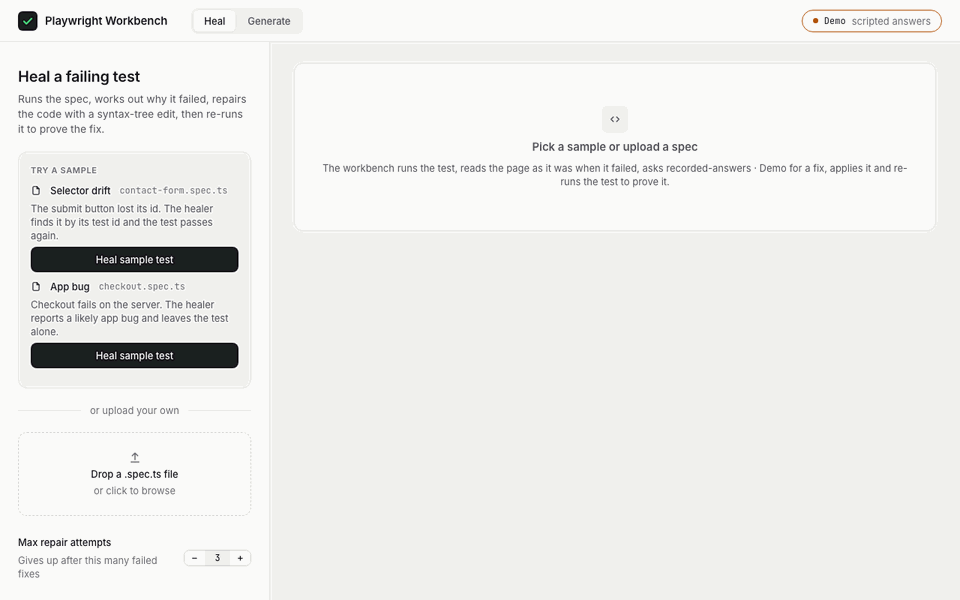
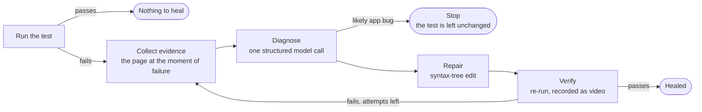
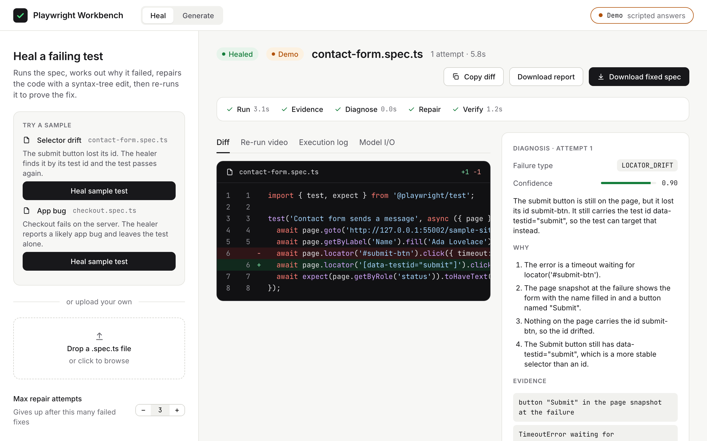
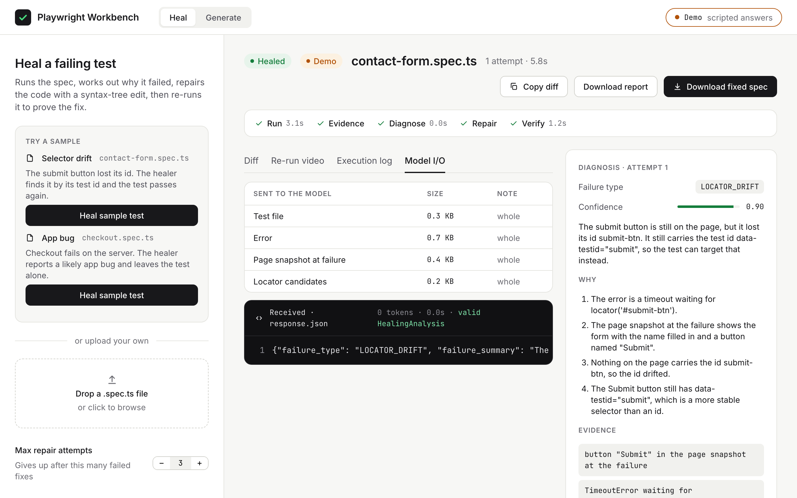
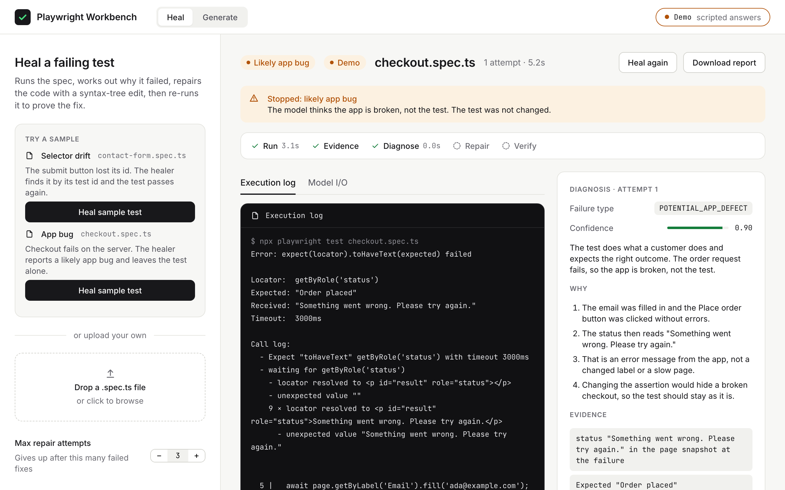
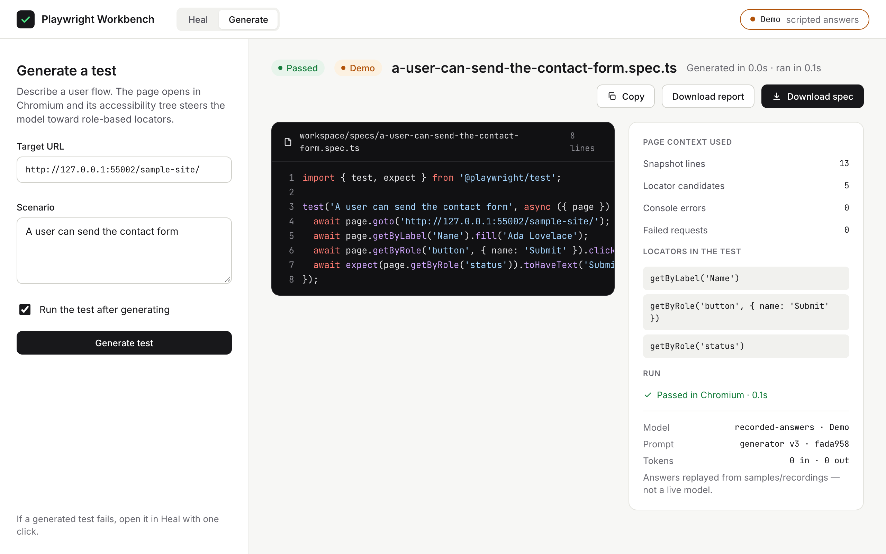

# ai-py-playwright-workbench

A local web app that generates Playwright tests and heals failing ones with a local LLM. It reads the page as it was when the test failed, repairs the code with a syntax-tree edit, re-runs the test to prove the fix, and refuses to patch a test when the app itself looks broken.

[](https://github.com/yashwant-das/ai-py-playwright-workbench/actions/workflows/ci.yml)
[](LICENSE)
[](https://www.python.org/)
[](https://playwright.dev/)



The recording uses the built-in Demo model, which replays recorded answers, so it looks the same on any machine.

## Why it exists

Playwright tests break as a UI changes. Most breaks are mechanical: a selector drifted, or a wait is too short. Some are not: the product is broken, and "healing" the test would hide the bug. This project is a small pipeline that tells the two apart and shows its work. Every run leaves a report with what the model saw, what it decided and why, and whether the fix held up when the test ran again. It works with local models through LM Studio or Ollama, and a scripted Demo model lets anyone try it without one.

## How it works



- **Evidence comes from the failure itself.** Playwright snapshots the page when a test fails; the healer reads that snapshot instead of reloading the start page.
- **The model's answer is structured and checked.** It is asked for JSON matching a schema, and the reply is validated with Pydantic before anything is done with it.
- **The fix is a constrained edit.** A named strategy changes the TypeScript syntax tree with ts-morph; an exact text replacement is the fallback.
- **The fix has to prove itself.** The test is re-run and the run is recorded as a video with each action captioned.
- **A suspected app bug stops the heal.** If the model is confident that the app is broken, the test is not edited.
- **Nothing is hidden.** The Model I/O view shows each section sent to the model with its size, the raw reply, and whether it passed validation.

Generate works the same way in one pass: the page's accessibility snapshot and locator candidates go to the model with your scenario, the model writes a spec, and the spec is run. [docs/architecture.md](docs/architecture.md) has the details.

## Quickstart

You need Python 3.13 with [uv](https://docs.astral.sh/uv/), Node.js 24, and a desktop browser window at least 1280px wide. A model is optional.

1. **Install.**

   ```bash
   git clone https://github.com/yashwant-das/ai-py-playwright-workbench.git
   cd ai-py-playwright-workbench
   uv sync
   npm ci
   npx playwright install chromium
   ```

2. **Start.**

   ```bash
   uv run workbench
   ```

   The app opens at <http://127.0.0.1:7860>. Press Ctrl+C to stop it.

3. **Heal the sample.** If no model server is running, press "Switch to demo model". Then press "Heal sample test" under **Selector drift** and watch the steps.

## Using the app

- **Models.** The pill at the top right shows the model in use; click it to change it. Start [LM Studio](https://lmstudio.ai/) (`http://localhost:1234/v1`) or [Ollama](https://ollama.com/) (`http://localhost:11434/v1`), pick the provider, choose a model and save. A server that is already running is found on start, and its first listed model is used. Demo needs no server and covers the two samples and the "Contact form" example.
- **Heal.** Try the two samples: **Selector drift** heals, and **App bug** stops with "likely app bug" and leaves the test alone. To heal your own test, drop one `.spec.ts` file (200 KB at most) on the upload area. A copy is healed; your file is never changed.
- **Generate.** Enter a URL and a scenario, or click the example. If the generated test fails, "Heal this test" sends it to Heal.
- **Output.** Everything is written under `workspace/`, which git ignores: specs, Playwright's output and videos, one JSON report per run, and the saved model choice. Delete the folder to start fresh.
- **Limits.** One run at a time. A model call is given 300 seconds; Cancel stops a run at once. There is no history page yet: a saved report can be reopened at `/reports/<id>`.
- **Security.** The app listens on 127.0.0.1 only and refuses requests from other sites. Tests you upload or generate are code that runs on your machine, so heal only files you trust. See [SECURITY.md](SECURITY.md).

## Screenshots

| | |
| --- | --- |
|  |  |
| **Healed.** The diff, the diagnosis and the proof. | **Model I/O.** What was sent and what came back. |
|  |  |
| **Likely app bug.** The test is left alone. | **Generate.** A new spec, run straight away. |

## How this compares to Playwright Test Agents

Playwright ships its own [Test Agents](https://playwright.dev/docs/test-agents): a planner, a generator and a healer. They solve a wider problem in a different way.

| | This workbench | Playwright Test Agents |
| --- | --- | --- |
| What it is | A standalone local web app with its own pipeline | Agent definitions ("collections of instructions and MCP tools") added with `npx playwright init-agents` and run from an AI tool such as VS Code, Claude Code, Codex or OpenCode |
| Model | A local model through LM Studio or Ollama | The model your AI tool uses |
| Scope | Generate one spec from a URL and a scenario; heal one failing spec | Explore an app and write a test plan, turn the plan into tests, and repair failing tests across a suite |
| How a fix is made | One schema-validated diagnosis per attempt, applied as a constrained edit, then verified by a re-run | The healer replays the failing steps, inspects the current UI, suggests a patch and re-runs until the test passes or guardrails stop the loop |
| When the app looks broken | Stops and leaves the test unchanged | The test is skipped |
| What you can inspect afterwards | A report per run: the evidence, the diagnosis and its confidence, the diff, a video of the re-run, and exactly what the model was sent and answered | The conversation and the edits in your AI tool |

Use Test Agents to build and maintain a real suite with a capable model. This project is for seeing how a healing pipeline can be made small, local and auditable.

## Tests and quality gates

CI runs four jobs on every push to `main` and every pull request:

- **Lint and types:** Ruff, strict mypy, `tsc`, ESLint, Prettier and markdownlint.
- **Unit:** pytest with no model, browser or network; the job fails under 85% line and branch coverage.
- **Integration:** real specs in Chromium against the bundled sample site, with the Demo model and a fake OpenAI-compatible server.
- **UI:** Playwright Test drives the whole app and covers every screen state, with axe accessibility checks on each one. The HTML report is attached to the run.

Locally:

```bash
uv run python -m pytest                    # unit tests
uv run python -m pytest tests/integration  # integration tests
npm run test:ui                            # UI tests
npm run lint                               # ESLint, Prettier, Ruff, mypy (strict), markdownlint
npm run type-check                         # TypeScript
```

## Tech stack

| Layer | Tool | Version | Why |
| --- | --- | --- | --- |
| Web app | FastAPI, Jinja, uvicorn | 0.142, 3.1, 0.54 | Server-rendered pages with no front-end build |
| Live updates | htmx with its SSE extension (vendored) | 2.0.11, 2.2.4 | Progress maps directly onto server-sent events; no JavaScript to maintain |
| Browser automation | Playwright (Python and Test) | 1.64.0 | Collects page context, runs specs, and snapshots the page when a test fails |
| Model client | OpenAI SDK | 2.14 | LM Studio and Ollama both speak the OpenAI API |
| Structured output | Pydantic | 2 | Validates every model reply and produces the schema the model is asked to follow |
| Code repair | ts-morph, TypeScript | 28, 5.9 | Edits the spec's syntax tree and leaves the rest of the file untouched |
| Code and diff display | Pygments, difflib | 2.21 | Highlighting and diffs on the server |
| Quality gates | Ruff, mypy, pytest, Playwright Test, axe, ESLint, Prettier, markdownlint | current | The same checks locally and in CI |

The reasons behind the larger choices are in [docs/decisions.md](docs/decisions.md).

## Project structure

```text
├── src/workbench/
│   ├── heal/        # the heal loop: evidence, planner, repair, classifier
│   ├── generate/    # page context in, spec out
│   ├── context/     # accessibility snapshot, console, page errors, requests
│   ├── llm/         # ChatModel, the OpenAI-compatible client, Demo
│   ├── web/         # routes, templates, styles, the request guard
│   ├── models/      # Pydantic contracts: reports, events, model output
│   ├── prompts/     # prompt files and their version manifest
│   ├── runner.py    # runs one spec and reads Playwright's JSON report
│   └── runs.py      # one background run at a time
├── samples/         # the sample site, sample specs and Demo recordings
├── tests/           # unit, integration and UI suites
└── docs/            # architecture, decisions, development
```

The full module map is in [AGENTS.md](AGENTS.md).

## Documentation

- [docs/architecture.md](docs/architecture.md): the parts, a run from start to finish, the heal loop, the report
- [docs/decisions.md](docs/decisions.md): why it is built this way
- [docs/development.md](docs/development.md): setup, tests, quality gates, conventions
- [ROADMAP.md](ROADMAP.md): what is done, what is planned and what was removed
- [CHANGELOG.md](CHANGELOG.md): what changed in each version
- [CONTRIBUTING.md](CONTRIBUTING.md) and [SECURITY.md](SECURITY.md)

## License

MIT. See [LICENSE](LICENSE).
