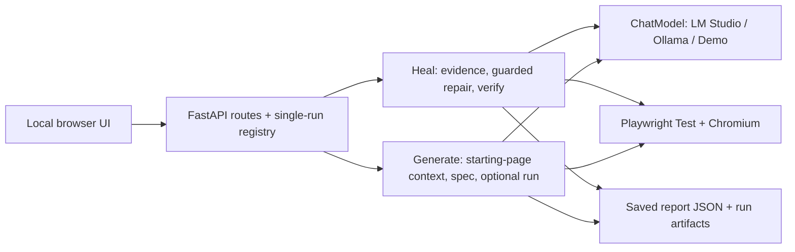

# ai-py-playwright-workbench

A local web app that generates Playwright tests and repairs failing ones with a local LLM. Heal uses failing-run evidence, applies a syntax-tree edit or text replacement, and keeps a repair only after a passing re-run. A confident model diagnosis of an application defect stops repair.

**Scope:** a guarded healing loop and a focused test generator.
Generate inspects the starting page once; it does not explore your scenario
before writing the test. Checks on visible form controls and page content are
the best fit. Multi-page journeys and controls revealed after interaction may
use guessed locators, even with a capable model.

[](https://github.com/yashwant-das/ai-py-playwright-workbench/actions/workflows/ci.yml)
[](LICENSE)
[](https://www.python.org/)
[](https://playwright.dev/)


The recording uses the built-in Demo model, which replays recorded answers, so it looks the same on any machine.

## What it demonstrates

Model-written test changes need evidence and an execution gate. This workbench
makes the proposed change, its diagnosis and its verification visible together:

- Failure-time page evidence is preferred over a fresh navigation; a new snapshot
  is collected only when the failing run left none.
- Model analysis is validated with Pydantic. A suspected app defect with confidence
  at least 0.7 stops Heal before editing; it is a model-based guard, not proof of a bug.
- Named repair strategies use a TypeScript AST where possible, with text
  replacement as a fallback. The original spec is restored unless Heal succeeds.
- Generate collects the starting page once, asks for a focused spec and optionally
  runs it. A failed generated spec can be sent to Heal explicitly.
- One background run streams numbered events to the UI. Reports expose available browser evidence and
  model exchanges; Heal adds the code diff. Prompt provenance and truncated input
  sections are inspectable.
- The Demo model replays bundled answers so the sample success and app-bug paths
  can be exercised without a model server or internet access.

## Architecture



The routes start and cancel runs; pipelines own model calls, browser execution
and report creation. The UI receives progress through HTMX/server-sent events
and renders saved results. [Architecture](docs/architecture.md) explains the
run lifecycle, repair guard and external boundaries.

### Project structure

```text
src/workbench/
  heal/, generate/, context/    repair and generation pipelines, page evidence
  llm/, models/, prompts/       model clients, validated contracts and versioned prompts
  web/                         routes, templates, styles and request guard
  runner.py, runs.py            Playwright subprocess and single-run/event lifecycle
samples/                       controlled site, specs and Demo recordings
tests/                         unit, Chromium integration and UI/axe checks
tooling/                       shared text/config checks
docs/                          maintained guides, Demo media and historical records
workspace/                     ignored specs, browser artifacts, reports and settings
```

### Tech stack

| Layer | Tool / version | Purpose |
| --- | --- | --- |
| Runtimes | Python 3.13; Node.js 24 | Python app and model/context work; Node test runner and AST repair |
| Web UI | FastAPI 0.159.1; Jinja2 3.1.6 | Local routes and server-rendered pages |
| Live progress | HTMX 2.0.11; SSE extension 2.2.4 | Vendored browser assets; streamed HTML updates without a frontend build |
| Browser tests | Playwright 1.64.0; TypeScript 6.0.3 | Matching Python/Node bindings, Chromium evidence and runnable specs |
| Model calls | OpenAI SDK 2.54.0; Pydantic 2.14.1 | OpenAI-compatible local endpoints and validated model output |
| Repair | ts-morph 28.0.0 | TypeScript AST changes with a text-replacement fallback |
| Quality gates | pytest 9.1.1; Ruff 0.17.1; mypy 2.4.0 | Offline unit checks, formatting and strict Python types |
| UI verification | Playwright Test 1.64.0; axe 4.14.0 | Whole-app behavior and accessibility in Chromium |

[pyproject.toml](pyproject.toml), [package.json](package.json),
[uv.lock](uv.lock) and [package-lock.json](package-lock.json) define package
versions; [.python-version](.python-version) and [.nvmrc](.nvmrc) select the
runtime baselines. The lockfiles are authoritative when a version is a range.

## Quickstart

You need Python 3.13 with [uv](https://docs.astral.sh/uv/), Node.js 24, and a desktop browser window at least 1280px wide. A model is optional.

1. **Install.**

   ```bash
   git clone https://github.com/yashwant-das/ai-py-playwright-workbench.git
   cd ai-py-playwright-workbench
   uv sync --locked --group dev
   npm ci
   npx playwright install chromium
   ```

2. **Start.**

   ```bash
   uv run workbench
   ```

   The app opens at <http://127.0.0.1:7860>. Press Ctrl+C to stop it.

3. **Heal the sample.** If no model server is running, press "Switch to demo model". Then press "Heal sample test" under **Selector drift**. Expect **Healed**, a one-line selector diff and a passing re-run. **App bug** should stop with "likely app bug" and retain the original test.

## Usage

- **Models.** The pill at the top right shows the model in use; click it to change it. Start [LM Studio](https://lmstudio.ai/) (`http://localhost:1234/v1`) or [Ollama](https://ollama.com/) (`http://localhost:11434/v1`), pick the provider, choose a model and save. On first start the app looks for local servers and chooses the first listed model; the model menu saves your later selection. Demo needs no server and covers the two samples and the "Contact form" example.
- **Heal.** Try the two samples: **Selector drift** heals, and **App bug** stops with "likely app bug" and leaves the test alone. To heal your own test, drop one `.spec.ts` file (200 KB at most) on the upload area. A copy is healed; your file is never changed.
- **Generate.** Enter a URL and a focused scenario, or choose an example to fill both fields. Public practice examples require LM Studio or Ollama and internet access; Demo supports the bundled Contact form. If the generated test fails, "Heal this test" sends it to Heal. Generation does not automatically revise a failed test.
- **Output.** Everything is written under `workspace/`, which git ignores: specs, Playwright's output and videos, one JSON report per run, and the saved model choice. Delete the folder to start fresh.
- **Limits.** One run at a time. Model calls have a 300-second timeout; cancellation interrupts the wait. There is no history page yet: a saved report can be reopened at `/reports/<id>`.
- **Security.** The app listens on 127.0.0.1, validates the Host header and refuses cross-origin state changes. Tests you upload or generate are code that runs on your machine, so heal only files you trust. See [SECURITY.md](SECURITY.md).

For runnable public scenarios and screenshots, see [generation examples](docs/generation.md).

## Verification

Run from the repository root after setup:

```bash
npm run lint                             # code, formatting, Python types and Markdown
npm run type-check                       # TypeScript
npm run test:tooling                     # offline text-checker behavior
uv run python -m pytest --cov             # offline unit tests; 85% coverage minimum
uv run python -m pytest tests/integration # Chromium, local sample site and scripted models
npm run test:ui                          # whole app in Chromium, Demo model and axe
```

The unit suite needs no model, browser or network. Integration and UI runs use
Chromium from the locked Playwright package; they do not need a live LLM.
These scripted runs do not establish compatibility with a particular real model.
CI runs lint/types, unit/coverage, controlled integration and UI jobs, plus
CodeQL. Playwright HTML reports can be opened after a UI run with
`npx playwright show-report`; CI retains uploaded browser reports for three days.
App reports are saved locally under `workspace/reports/` and reopened through
`/reports/<id>`; they are not published to a hosted report site.
[Development](docs/development.md) documents prerequisites, hooks and check scope.

## Documentation

- [Development](docs/development.md): setup, checks, conventions and adoption evidence.
- [Architecture](docs/architecture.md): components, execution flow, boundaries and reports.
- [Decisions](docs/decisions.md): rationale and the comparison with Playwright Test Agents.
- [Generation examples](docs/generation.md): tested practice scenarios, limits and screenshots; kept separately because model-dependent examples need their own evidence.
- [Roadmap](ROADMAP.md): completed and deferred work.
- [Changelog](CHANGELOG.md): release history.
- [Historical design records](docs/superpowers/README.md): implementation plans and the v2 design, retained as context rather than current setup instructions.
- [Contributing](CONTRIBUTING.md) and [security](SECURITY.md): contribution and reporting policies.

## License

MIT. See [LICENSE](LICENSE).
