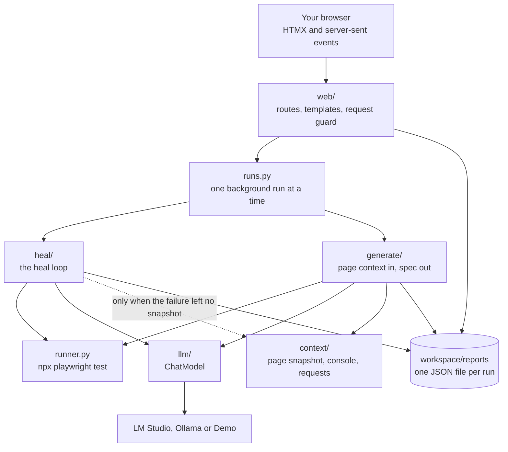
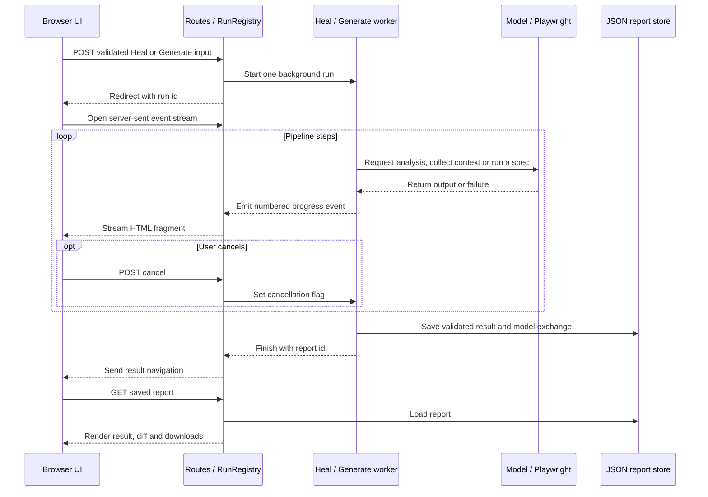

# Architecture

How the workbench is put together: the parts, what happens during a run, the
heal loop step by step, and what each run leaves behind. The reasons for these
choices are in [decisions.md](decisions.md).

## The parts

Three rules keep the parts apart:

- **Pipelines do not know about the web.** `heal()` and `generate()` are plain
  functions that take their collaborators as arguments (`model`, `run`,
  `collect`, `browsers_ready`) and return a report. Unit tests pass fakes.
- **Pipelines talk to a model only through `ChatModel`** (`llm/chat.py`). The
  two implementations are `OpenAICompatibleModel` for LM Studio and Ollama, and
  `DemoModel`, which replays recorded answers.
- **The web layer reaches everything else through `Services`**
  (`web/services.py`), one dataclass holding the pipelines, the model client
  and the checks. Route tests replace its fields.

The implementation module map is in [AGENTS.md](../AGENTS.md#layout).

## What happens during a run

The diagram shows a normal pipeline return; unexpected worker failures are
described below.

1. The browser posts the form (`POST /heal` or `POST /generate`). The request
   guard has already checked the `Host` and `Origin` headers.
2. The route validates the input, builds the model from the saved choice, and
   asks `RunRegistry` to start the pipeline in a background thread. Only one
   run may be active; a second start is answered with 409.
3. The route answers with a redirect to the same page with `?run=<id>`. That
   page opens a server-sent events stream at `/runs/<id>/events`.
4. The pipeline emits numbered `RunEvent`s (step started, step finished, log
   line, attempt ended, done). The stream renders each one as a small HTML
   fragment, and HTMX swaps it into the page. Events are kept, so a reloaded
   page replays them from the start.
5. On a normal pipeline return, the report is saved and the stream navigates
   to `/reports/<id>`. If the worker raises an unexpected exception, the registry
   records an error and frees the run slot; a saved report is not guaranteed.
   Running a previously unrun generated spec updates its existing report.

Live run ids and events are held in memory for the latest 20 runs. Report ids
identify the saved JSON separately; saved reports remain available after an app
restart even though the live event stream does not.

Cancel sets a flag the pipeline checks between steps. The model call runs on
its own thread (`llm/cancellable.py`), so a cancel during a slow model answer
returns at once. Playwright runs in its own process group, so cancelling also
stops the browsers it started.

## The heal loop

`heal()` in `heal/pipeline.py`. The spec file is edited in place, and restored
to its original bytes unless the result is `healed`, even if an exception is
raised.

| Step | What happens | Ends the heal when |
| --- | --- | --- |
| Run | `runner.py` runs the spec with `npx playwright test` and reads Playwright's JSON report. | It passes (`nothing_to_heal`), or the run cannot start (`error`). |
| Evidence | `heal/evidence.py` reads Playwright's `error-context.md` from the failing run: the page snapshot at the moment of failure. Only if it is missing is the spec's first URL opened in a fresh browser. | Never. |
| Diagnose | `heal/classifier.py` gives a hint from the error text. `heal/planner.py` sends the test, the error and the evidence to the model, asks for JSON matching the `HealingAnalysis` schema, and validates the reply with Pydantic. | The model cannot be reached (`error`). An invalid reply ends only this attempt. |
| Guard | If the diagnosis is `POTENTIAL_APP_DEFECT` with confidence 0.7 or more, the heal stops. | Always, with `app_defect_suspected`. The test is not edited. |
| Repair | `heal/repair.py` applies the fix. Named strategies (`selector_replace`, `timeout_adjust`, `role_argument`, `import_add`, `assertion_swap`) edit the TypeScript syntax tree through `heal/ast_repair.js` (ts-morph). `string_replace`, and any strategy that cannot be applied to the tree, uses text replacement with exact or indentation-tolerant matching. | Never. If the code to replace is not in the file, the attempt ends as `not_applied`. |
| Verify | The spec is run again, recorded as a video with each action captioned. | It passes (`healed`). |

A failed attempt starts the next one from the latest failure, up to the chosen
number of attempts (1 to 5, default 3). When they run out the result is
`not_healed`.

What the model sees is capped per section (12,000 characters for the test file
and for the page snapshot, 2,000 for each of the others). The report records
each section's size and whether it was cut.

## Generation

`generate()` in `generate/pipeline.py`:

1. **Context.** `context/collector.py` opens the URL once in Chromium and
   collects the accessibility snapshot (`aria_snapshot(mode="ai")`), locator
   candidates, console errors and failed requests.
2. **Model.** The model gets the URL, the scenario and that context, and
   answers with a Playwright spec.
3. **Run (optional).** The spec is written to `workspace/specs/` and run. A
   failed run can be sent to Heal with one click.

The generator does not explore later pages or inspect controls revealed after
interaction. The Generate form explains this limitation and offers practice-site
presets. Public presets require a local model; Demo only offers its recorded
Contact form. Presets populate the form without starting work. The bundled
Checkout example intentionally demonstrates an app failure.

## What a run leaves behind

Everything is under `workspace/` (git-ignored):

| Path | Content |
| --- | --- |
| `workspace/specs/` | Sample, uploaded and generated specs |
| `workspace/runs/<report id>/` | Playwright's output for each run of that heal or generation: JSON report, screenshot, `error-context.md`, video |
| `workspace/reports/<report id>.json` | The report |
| `workspace/settings.json` | The saved model choice |

A report is one Pydantic model (`models/heal.py`, `models/generate.py`):

- **`HealReport`**: status, the original and final code, the diff, the first
  run, and a list of `Attempt`s.
- **`Attempt`**: outcome (`healed`, `rerun_failed`, `not_applied`,
  `invalid_reply`, `app_defect`, `cancelled`), the evidence, the model's
  analysis, how the fix was applied (`ast` or `text`), the re-run, and the
  `ModelExchange`.
- **`ModelExchange`**: the named sections sent to the model with their sizes,
  the raw reply, whether it passed validation, and its provenance (provider,
  model, prompt name, version and hash, token counts, latency).
- **`GenerateReport`**: status, URL, scenario, the code, a summary of the page
  context, the `ModelExchange`, and the run.

The UI, the downloads and the tests all read this one object.

## Models and settings

- **LM Studio and Ollama** expose OpenAI-compatible chat endpoints, so one
  client covers both. Heal requests a JSON schema; if the server rejects it
  (HTTP 400), the call is retried once without it and Pydantic still validates
  the analysis. Generate requests code, extracts it and checks that it is
  non-empty; TypeScript validity and behavior are established only by execution
  or separate checks.
- **Demo** replays the answers in `samples/recordings/`, matched by the test or
  the scenario. A request it has no recording for gets a clear error, not an
  invented answer. Demo runs are labelled everywhere.
- On first start the app looks for a server on the default ports and uses the
  first model it lists. The choice made in the model menu is saved in
  `workspace/settings.json`. No environment variable configures the app.

## HTTP routes

| Route | Purpose |
| --- | --- |
| `GET /` | Redirects to `/heal` |
| `GET /heal`, `GET /generate` | The two pages |
| `POST /heal` | Start a heal: a sample, an upload or a generated test |
| `POST /generate` | Start a generation |
| `POST /generate/run` | Run a generated spec that was not run |
| `GET /runs/{id}/events` | The live stream of a run |
| `POST /runs/{id}/cancel` | Cancel a run |
| `GET /runs/{id}/result` | Where a finished run's page should go |
| `GET /reports/{id}` | A result page |
| `GET /reports/{id}.json`, `GET /reports/{id}/spec`, `GET /reports/{id}/video` | Report JSON, spec and available Heal re-run video |
| `GET /model`, `POST /model/test`, `POST /model` | The model menu: show, test a server, save |
| `GET /sample-site/…` | The sample web app the samples run against |
| `GET /healthz` | Liveness check |

## Safety properties

- The app listens on `127.0.0.1` only. `web/guard.py` answers only requests
  whose `Host` is `127.0.0.1` or `localhost`, and refuses state-changing
  requests that come from another origin.
- `heal()` leaves the spec unchanged unless the status is `healed`.
- A model diagnosis of `POTENTIAL_APP_DEFECT` at confidence 0.7 or higher stops the heal before applying that attempt’s edit; the original spec is restored.
- One run at a time; Ctrl+C cancels the active run before the server exits.
- Report ids are validated before they are used as file names.

## Tests

| Level | Where | What is real |
| --- | --- | --- |
| Unit | `tests/unit/` | Nothing external: no model, no browser, no network. Routes use FastAPI's `TestClient` with fake services. |
| Integration | `tests/integration/` | Chromium, Playwright Test, the sample site and the Demo model, plus a fake OpenAI-compatible server. |
| UI | `tests/ui/` | The whole app in Chromium, driven by Playwright Test with the Demo model, with axe accessibility checks on every state. |

How to run them is in [development.md](development.md).

## Tooling and versions

Python owns the web app, model calls and context collection; Node owns Playwright
Test and syntax-tree repair. Each manifest remains at the repository root. See
[pyproject.toml](../pyproject.toml) and [package.json](../package.json) for direct
dependencies, and [uv.lock](../uv.lock) and [package-lock.json](../package-lock.json)
for resolved versions. Browser binaries come from the locked Playwright package.
Vendored HTMX and its SSE extension live in `src/workbench/web/static/vendor/`.
