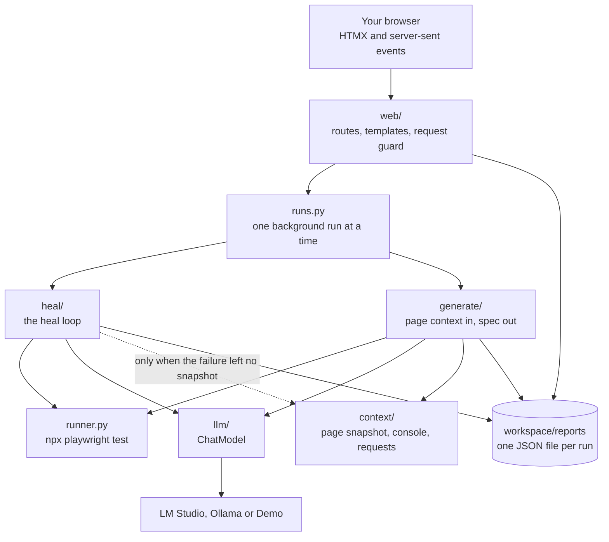
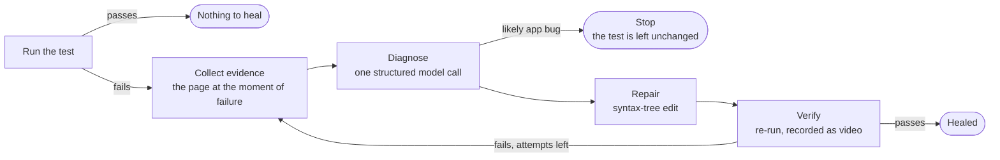

# v2 Phase 6: Showcase and 2.0.0 Implementation Plan

> **For agentic workers:** REQUIRED SUB-SKILL: Use superpowers:executing-plans to implement this plan task-by-task, inline in one session. Do not dispatch subagents without the user's approval. Steps use checkbox (`- [ ]`) syntax for tracking.

**Goal:** Make the project explain itself in under a minute (README with a GIF of a heal, screenshots and a comparison with Playwright Test Agents), write the three documents the spec asks for, and prepare version 2.0.0 for `main`.

**Architecture:**

- **Assets are reproducible.** A capture script drives the real app with the Demo model through the UI suite's fixture, saves the screenshots, and films the frames a small Pillow script turns into the GIF. `npm run docs:capture` rebuilds all of them.
- **Docs are checked.** A unit test file fails when a document's relative link, image or `npm run` command points at something that does not exist, and when the version differs between files.
- **Documents are written once.** Each new document's full text is in this plan; execution copies it out.

**Tech Stack:**

- Markdown, Mermaid (rendered by GitHub), markdownlint
- `@playwright/test` 1.63.0 with the fixture in `tests/ui/support/app.ts`
- Pillow, used only by the GIF script through `uv run --with pillow` (not a project dependency)
- `gh` for the pull request and the release

**Spec:** [docs/superpowers/specs/2026-10-03-v2-showcase-simplification-design.md](../specs/2026-10-03-v2-showcase-simplification-design.md). The relevant sections are:

- §1 The pitch, and §2 success criterion S7
- §4 Decisions D1 to D15
- §8 Quality gates (amended in Task 1)
- §9 Documentation and tracking
- §11 Phase 6

## Global Constraints

- **README (§9):** pitch, GIF, three-step quick start, how it works with one diagram, screenshots, "How this compares to Playwright Test Agents", tech stack with reasons, links. It follows the section order of the portfolio template already used on `main`.
- **Docs (§9):** exactly three files under `docs/`: `architecture.md`, `decisions.md`, `development.md`. `CONTRIBUTING.md` and `SECURITY.md` are updated.
- **Honesty:** the GIF and screenshots use the Demo model, and the README says so. No number is published that a reader cannot reproduce.
- **Version:** 2.0.0 in `pyproject.toml`, `package.json` and both lock files; `CHANGELOG.md` gets a `## [2.0.0]` section in Keep a Changelog format.
- **Docs lint clean:** `npm run lint:md` reports no issues.
- **No new dependencies, environment variables or app behaviour.** This phase changes documents, assets, version strings and one CI step.
- **Never push, open a pull request, tag or publish a release without the user's yes for that step.**
- **Commits:** Conventional Commits, ending with `Co-Authored-By: Claude Opus 5.5 <noreply@anthropic.com>`.

## Review Focus

1. **A reader on a clean machine follows the Quickstart.** Every command must work as written. Pinned in Task 7 Step 2: the commands run in a fresh clone and the app answers.
2. **A link or image that works locally is broken on GitHub.** Pinned in Task 3: `test_relative_links_resolve` checks every relative link and image in every document.
3. **A document tells the reader to run a command that no longer exists.** Pinned in Task 3: `test_npm_commands_in_the_docs_exist`.
4. **The GIF is too heavy to load or is an old recording.** Pinned in Task 2: the GIF must be under 5 MB and have more than 20 frames (the 1.0 GIF has 5).
5. **The version differs between files after the bump.** Pinned in Task 6: `test_the_release_version_is_the_same_everywhere`.

## Plan decisions

- **P1. v2 follows `main` on Codecov (the user's answer, 2026-10-11).** `main` removed Codecov in PR #18 on 2026-09-30; v2 branched before that and its spec still asked for it. The upload goes, the spec gets a dated amendment, and the README shows no coverage badge. Coverage still prints in the CI job summary and the build still fails under 85%.
- **P2. The model timeout stays at 300 seconds (the user's answer).** No code change.
- **P3. 2.0.0 lands through a pull request from `v2` to `main` (the user's answer).** Task 7 opens it and stops. Tagging and the GitHub release happen after the user merges, each with its own yes.
- **P4. The GIF is built from screenshots, not from a video.** No `ffmpeg` is installed on this machine, and Playwright's bundled copy cannot write GIFs. Pillow assembles filmed screenshots, run through `uv run --with pillow` so it never becomes a dependency.
- **P5. The README keeps the section order of the template on `main`** (Why it exists, how it works, Quickstart, tests, tech stack, project structure, documentation, license) and adds what the spec asks for (screenshots, the comparison).
- **P6. The comparison with Playwright Test Agents states only what Playwright's own documentation says** (<https://playwright.dev/docs/test-agents>, read 2026-10-11): three agents (planner, generator, healer), added with `npx playwright init-agents`, run from an AI tool, described as "collections of instructions and MCP tools"; the healer's output is a passing test or "a skipped test if the healer believes that functionality is broken".
- **P7. Out of scope.** The Figma file (still blocked), the deferred minors from earlier phases, renaming the repository.
- **P8. Final review.** A self-review, as in Phase 5, unless the user approves one reviewer subagent.

## File map

| File | Task | Purpose |
| --- | --- | --- |
| `.github/workflows/ci.yml`, spec §8 | 1 | No Codecov upload |
| `tests/unit/test_quality_gates.py` | 1 | Pins it |
| `playwright.capture.config.ts`, `tests/ui/capture/showcase.capture.ts`, `tests/ui/capture/make_gif.py` | 2 | Capture the screenshots and the GIF |
| `docs/assets/demo.gif`, `heal-healed.png`, `heal-model-io.png`, `heal-app-bug.png`, `generate-passed.png` | 2 | The assets |
| `tests/unit/test_docs.py` | 2–5 | Checks assets, links, commands and the guides |
| `docs/architecture.md`, `docs/decisions.md`, `docs/development.md` | 3 | The three documents |
| `README.md` | 4 | The showcase |
| `CONTRIBUTING.md`, `SECURITY.md`, `AGENTS.md` | 5 | Brought up to date |
| `pyproject.toml`, `package.json`, lock files, `CHANGELOG.md`, `ROADMAP.md`, `tests/unit/test_versions.py` | 6 | Version 2.0.0 |

---

### Task 1: CI follows main: no Codecov

**Files:**

- Modify: `tests/unit/test_quality_gates.py`, `.github/workflows/ci.yml`
- Modify: `docs/superpowers/specs/2026-10-03-v2-showcase-simplification-design.md` (§8), `CHANGELOG.md`, `ROADMAP.md`

**Interfaces:**

- Consumes: `WORKFLOWS` in `tests/unit/test_quality_gates.py`.
- Produces: nothing.

- [ ] **Step 1: Write the failing test**

Append to `tests/unit/test_quality_gates.py`:

```python
def test_ci_reports_coverage_in_the_job_summary_only() -> None:
    text = (WORKFLOWS / "ci.yml").read_text(encoding="utf-8")
    assert "codecov" not in text.lower()
    assert "--cov-report=xml" not in text
    assert "--cov-report=markdown-append" in text
```

Run: `uv run python -m pytest tests/unit/test_quality_gates.py`
Expected: 1 failed (`assert "codecov" not in …`), 6 passed.

- [ ] **Step 2: Remove the upload**

In `.github/workflows/ci.yml`, in the `unit` job, replace the coverage step and delete the "Upload coverage to Codecov" step that follows it:

```yaml
      # Fails under 85% line and branch coverage (pyproject.toml).
      - name: Unit tests with coverage
        run: |
          uv run python -m pytest -q --cov --cov-report=term --cov-report=markdown-append:"$GITHUB_STEP_SUMMARY"
```

Run: `uv run python -m pytest tests/unit/test_quality_gates.py`
Expected: 7 passed.

- [ ] **Step 3: Amend the spec and the guides**

- Spec §8: replace the sentence "Codecov keeps receiving coverage. The README shows three badges: CI, coverage, license." with "Coverage is printed in the unit job's summary and the job fails under 85%. The README shows two badges: CI and license. (Amended 2026-10-11: `main` removed Codecov in PR #18 before v2 merged, and v2 follows it.)" In the gates table, leave the Unit tests row as it is.
- `CHANGELOG.md` → `### Removed`: `The Codecov upload. Coverage is printed in the CI job summary, and the build fails under 85%.`
- `ROADMAP.md`, "Now": set the Phase 6 row to `🚧 In progress` with the plan link `[Phase 6](docs/superpowers/plans/2026-10-11-v2-phase-6-showcase.md)`.

- [ ] **Step 4: Verify and commit**

Run: `uv run python -m pytest && npm run lint`
Expected: all pass.

```bash
git add tests/unit/test_quality_gates.py .github/workflows/ci.yml docs/superpowers/specs CHANGELOG.md ROADMAP.md
git commit -m "ci: stop uploading coverage to Codecov, as on main"
```

---

### Task 2: Showcase assets: screenshots and the GIF

**Files:**

- Create: `tests/unit/test_docs.py`, `playwright.capture.config.ts`, `tests/ui/capture/showcase.capture.ts`, `tests/ui/capture/make_gif.py`
- Create: `docs/assets/heal-healed.png`, `heal-model-io.png`, `heal-app-bug.png`, `generate-passed.png`; replace `docs/assets/demo.gif`
- Modify: `package.json`, `tsconfig.json`

**Interfaces:**

- Consumes: `test`, `expect` from `tests/ui/support/app.ts`; `expectResult`, `resultViews` from `tests/ui/support/page.ts`.
- Produces: npm script `docs:capture`; the five files under `docs/assets/` (Task 4's README shows them); `tests/unit/test_docs.py` with `_read`, `ASSETS` and `SCREENSHOTS` (Tasks 3 to 5 add to it).

- [ ] **Step 1: Write the failing tests**

Create `tests/unit/test_docs.py`:

```python
"""The documentation set in the v2 spec (section 9) exists, and what it points at is real."""

import pytest

from workbench.config import PROJECT_ROOT

ASSETS = PROJECT_ROOT / "docs" / "assets"
SCREENSHOTS = [
    "heal-healed.png",
    "heal-model-io.png",
    "heal-app-bug.png",
    "generate-passed.png",
]
MB = 1024 * 1024


def _read(name: str) -> str:
    return (PROJECT_ROOT / name).read_text(encoding="utf-8")


def test_the_demo_gif_is_a_real_recording_small_enough_for_a_readme() -> None:
    data = (ASSETS / "demo.gif").read_bytes()
    assert data[:6] == b"GIF89a"
    # Each frame starts with a graphic control extension; the 1.0 GIF had five.
    assert data.count(b"\x21\xf9\x04") > 20
    assert len(data) < 5 * MB


@pytest.mark.parametrize("name", SCREENSHOTS)
def test_screenshots_exist_and_are_not_huge(name: str) -> None:
    data = (ASSETS / name).read_bytes()
    assert data[:8] == b"\x89PNG\r\n\x1a\n"
    assert len(data) < 1.5 * MB
```

Run: `uv run python -m pytest tests/unit/test_docs.py`
Expected: 5 failed (the GIF has 5 frames; the four screenshots do not exist).

- [ ] **Step 2: Write the capture config and script**

Create `playwright.capture.config.ts`:

```ts
import { defineConfig, devices } from '@playwright/test';

/**
 * Captures the README's screenshots and the frames of its GIF: `npm run docs:capture`.
 * Not a test suite: it drives the real app with the Demo model and writes to docs/assets/.
 */
export default defineConfig({
  testDir: 'tests/ui/capture',
  testMatch: /.*\.capture\.ts$/,
  outputDir: 'test-results/capture',
  workers: 1,
  timeout: 120_000,
  reporter: [['list']],
  use: {
    ...devices['Desktop Chrome'],
    viewport: { width: 1280, height: 800 },
    deviceScaleFactor: 2,
  },
});
```

Create `tests/ui/capture/showcase.capture.ts`:

```ts
import { mkdirSync, rmSync } from 'node:fs';
import path from 'node:path';

import type { Page } from '@playwright/test';

import { expect, test } from '../support/app';
import { expectResult, resultViews } from '../support/page';

test.use({ appOptions: { model: 'demo' } });

const ROOT = path.resolve(__dirname, '..', '..', '..');
const ASSETS = path.join(ROOT, 'docs', 'assets');
const FRAMES = path.join(ROOT, 'test-results', 'capture-frames');

/** Screenshots the page over and over until stopped; make_gif.py turns the files into the GIF. */
function film(page: Page): { stop: () => Promise<void> } {
  const started = Date.now();
  let filming = true;
  const loop = (async () => {
    while (filming) {
      const name = String(Date.now() - started).padStart(6, '0');
      // A page that is mid-navigation cannot be captured; the next pass will be.
      await page
        .screenshot({ path: path.join(FRAMES, `${name}.png`), scale: 'css' })
        .catch(() => undefined);
      await page.waitForTimeout(80);
    }
  })();
  return {
    stop: async () => {
      filming = false;
      await loop;
    },
  };
}

test('the heal GIF and the heal screenshots', async ({ page }) => {
  rmSync(FRAMES, { recursive: true, force: true });
  mkdirSync(FRAMES, { recursive: true });
  await page.goto('/heal');
  await expect(page.getByRole('heading', { name: 'Pick a sample or upload a spec' })).toBeVisible();
  const sample = page.getByRole('button', { name: 'Heal the Selector drift sample' });

  const camera = film(page);
  await page.waitForTimeout(1200);
  await sample.hover();
  await page.waitForTimeout(500);
  await sample.click();
  await expectResult(page, 'Healed');
  await page.waitForTimeout(2600);
  await resultViews(page).getByRole('link', { name: 'Model I/O' }).click();
  await expect(page.getByRole('columnheader', { name: 'Sent to the model' })).toBeVisible();
  await page.waitForTimeout(2400);
  await camera.stop();

  await page.screenshot({ path: path.join(ASSETS, 'heal-model-io.png') });
  await resultViews(page).getByRole('link', { name: 'Diff' }).click();
  await expect(page.getByRole('region', { name: 'Diff' })).toBeVisible();
  await page.screenshot({ path: path.join(ASSETS, 'heal-healed.png') });
});

test('the app-bug screenshot', async ({ page }) => {
  await page.goto('/heal');
  await page.getByRole('button', { name: 'Heal the App bug sample' }).click();
  await expectResult(page, 'Likely app bug');
  await page.screenshot({ path: path.join(ASSETS, 'heal-app-bug.png') });
});

test('the generate screenshot', async ({ page }) => {
  await page.goto('/generate?example=contact-form');
  await page.getByRole('button', { name: 'Generate test' }).click();
  await expectResult(page, 'Passed');
  await page.screenshot({ path: path.join(ASSETS, 'generate-passed.png') });
});
```

Create `tests/ui/capture/make_gif.py`:

```python
"""Builds docs/assets/demo.gif from the frames `npm run docs:capture` filmed.

That script runs it as:  uv run --with pillow python tests/ui/capture/make_gif.py
Pillow is needed only here, so it is not a project dependency.
"""

from pathlib import Path

from PIL import Image

ROOT = Path(__file__).resolve().parents[3]
FRAMES = ROOT / "test-results" / "capture-frames"
TARGET = ROOT / "docs" / "assets" / "demo.gif"
WIDTH = 960
COLOURS = 128
LAST_FRAME_MS = 2500
MAX_FRAME_MS = 3000
PALETTE_SAMPLES = 8


def _shared_palette(frames: list[Image.Image]) -> Image.Image:
    """One palette for every frame, so unchanged pixels stay identical between frames."""
    step = max(1, len(frames) // PALETTE_SAMPLES)
    samples = frames[::step]
    sheet = Image.new("RGB", (WIDTH, sum(frame.height for frame in samples)))
    top = 0
    for frame in samples:
        sheet.paste(frame, (0, top))
        top += frame.height
    return sheet.quantize(colors=COLOURS, method=Image.Quantize.MEDIANCUT)


def main() -> None:
    paths = sorted(FRAMES.glob("*.png"))
    if len(paths) < 2:
        raise SystemExit(f"No frames in {FRAMES}. Run: npm run docs:capture")
    times = [int(path.stem) for path in paths] + [int(paths[-1].stem) + LAST_FRAME_MS]

    frames: list[Image.Image] = []
    durations: list[int] = []
    for index, path in enumerate(paths):
        shown_ms = times[index + 1] - times[index]
        with Image.open(path) as image:
            height = round(image.height * WIDTH / image.width)
            frame = image.convert("RGB").resize(
                (WIDTH, height), Image.Resampling.LANCZOS
            )
        if frames and frame.tobytes() == frames[-1].tobytes():
            # Nothing moved: show the last frame for longer instead of storing it again.
            durations[-1] = min(durations[-1] + shown_ms, MAX_FRAME_MS)
            continue
        frames.append(frame)
        durations.append(shown_ms)

    palette = _shared_palette(frames)
    indexed = [
        frame.quantize(palette=palette, dither=Image.Dither.NONE) for frame in frames
    ]
    indexed[0].save(
        TARGET,
        save_all=True,
        append_images=indexed[1:],
        duration=durations,
        loop=0,
        optimize=True,
    )
    size_kb = TARGET.stat().st_size / 1024
    print(f"{TARGET.relative_to(ROOT)}: {len(indexed)} frames, {size_kb:.0f} KB")


if __name__ == "__main__":
    main()
```

In `package.json` `scripts`, after `test:ui`:

```json
    "docs:capture": "playwright test --config playwright.capture.config.ts && uv run --with pillow python tests/ui/capture/make_gif.py",
```

In `tsconfig.json`, add `"playwright.capture.config.ts"` to `include`, after `"playwright.ui.config.ts"`.

- [ ] **Step 3: Capture**

Run: `npm run docs:capture`
Expected: 3 passed, then a line such as `docs/assets/demo.gif: 60 frames, 900 KB`.

If the GIF is over 3 MB, lower `COLOURS` to 64 in `make_gif.py` and run `uv run --with pillow python tests/ui/capture/make_gif.py` again; record a `Ruling:`.

- [ ] **Step 4: Look at the results**

Open each of the four PNG files and three or four frames from `test-results/capture-frames/` (an early one, one from the live run, the last one). Check: the page is fully rendered, the status pill reads as expected, nothing is cut off, and no frame is blank. A problem is fixed in the capture script (a wait on the right element), not by editing an image.

- [ ] **Step 5: Run the tests and the lint**

Run: `uv run python -m pytest tests/unit/test_docs.py && npx prettier --write tests/ui playwright.capture.config.ts && uv run ruff format tests/ui && npm run lint && npm run type-check`
Expected: 5 passed; lint and type-check clean.

Run: `npm run test:ui -- --list | tail -1`
Expected: `Total: 36 tests in 7 files` (the capture file is not part of the suite).

- [ ] **Step 6: Commit**

```bash
git add tests/unit/test_docs.py playwright.capture.config.ts tests/ui/capture docs/assets package.json tsconfig.json
git commit -m "docs: capture the README screenshots and the heal GIF from the real app"
```

---

### Task 3: The three documents

**Files:**

- Create: `docs/architecture.md`, `docs/decisions.md`, `docs/development.md`
- Modify: `tests/unit/test_docs.py`

**Interfaces:**

- Consumes: `_read` in `tests/unit/test_docs.py`.
- Produces: `DOCS`, `_prose` in `tests/unit/test_docs.py`; the three documents (the README links to them in Task 4).

- [ ] **Step 1: Write the failing tests**

In `tests/unit/test_docs.py`, change the imports to:

```python
import json
import re

import pytest

from workbench.config import PROJECT_ROOT
```

and append:

```python
DOCS = [
    "README.md",
    "ROADMAP.md",
    "CHANGELOG.md",
    "CONTRIBUTING.md",
    "SECURITY.md",
    "AGENTS.md",
    "docs/architecture.md",
    "docs/decisions.md",
    "docs/development.md",
]
_FENCE = re.compile(r"^(`{3,})[^\n]*\n.*?^\1[ \t]*$", re.MULTILINE | re.DOTALL)
_LINK = re.compile(r"!?\[[^\]]*\]\(<?([^)\s>]+)>?[^)]*\)")
_NPM_SCRIPT = re.compile(r"npm run ([a-z][\w:-]*)")
_ELSEWHERE = ("http://", "https://", "mailto:", "#")


def _prose(name: str) -> str:
    """The document without its fenced code blocks."""
    return _FENCE.sub("", _read(name))


@pytest.mark.parametrize("name", DOCS)
def test_relative_links_resolve(name: str) -> None:
    folder = (PROJECT_ROOT / name).parent
    targets = [t for t in _LINK.findall(_prose(name)) if not t.startswith(_ELSEWHERE)]
    missing = [t for t in targets if not (folder / t.split("#")[0]).exists()]
    assert missing == []


@pytest.mark.parametrize("name", DOCS)
def test_npm_commands_in_the_docs_exist(name: str) -> None:
    scripts = json.loads(_read("package.json"))["scripts"]
    unknown = sorted(set(_NPM_SCRIPT.findall(_read(name))) - set(scripts))
    assert unknown == []
```

Run: `uv run python -m pytest tests/unit/test_docs.py`
Expected: 6 failed (`FileNotFoundError` for the three documents, in both tests), 17 passed.

- [ ] **Step 2: Write the architecture document**

Create `docs/architecture.md`:

````markdown
# Architecture

How the workbench is put together: the parts, what happens during a run, the
heal loop step by step, and what each run leaves behind. The reasons for these
choices are in [decisions.md](decisions.md).

## The parts



Three rules keep the parts apart:

- **Pipelines do not know about the web.** `heal()` and `generate()` are plain
  functions that take their collaborators as arguments (`model`, `run`,
  `collect`, `browsers_ready`) and return a report. Unit tests pass fakes.
- **Pipelines talk to a model only through `ChatModel`** (`llm/chat.py`). The
  two implementations are `OpenAICompatibleModel` for LM Studio and Ollama, and
  `DemoModel`, which replays recorded answers.
- **The web layer reaches everything else through `Services`**
  (`web/services.py`), one dataclass holding the pipelines, the model client
  and the checks. Route tests replace its fields.

The module map, with one line per file, is in [AGENTS.md](../AGENTS.md).

## What happens during a run

1. The browser posts the form (`POST /heal` or `POST /generate`). The request
   guard has already checked the `Host` and `Origin` headers.
2. The route validates the input, builds the model from the saved choice, and
   asks `RunRegistry` to start the pipeline in a background thread. Only one
   run may be active; a second start is answered with 409.
3. The route answers with a redirect to the same page with `?run=<id>`. That
   page opens a server-sent events stream at `/runs/<id>/events`.
4. The pipeline emits numbered `RunEvent`s (step started, step finished, log
   line, attempt ended, done). The stream renders each one as a small HTML
   fragment, and HTMX swaps it into the page. Events are kept, so a reloaded
   page replays them from the start.
5. When the pipeline returns, it has saved its report. The stream sends a last
   fragment that takes the browser to `/reports/<id>`, which renders the saved
   report. A reload therefore always shows the same result.

Cancel sets a flag the pipeline checks between steps. The model call runs on
its own thread (`llm/cancellable.py`), so a cancel during a slow model answer
returns at once. Playwright runs in its own process group, so cancelling also
stops the browsers it started.

## The heal loop

`heal()` in `heal/pipeline.py`. The spec file is edited in place, and restored
to its original bytes unless the result is `healed`, even if an exception is
raised.

| Step | What happens | Ends the heal when |
| --- | --- | --- |
| Run | `runner.py` runs the spec with `npx playwright test` and reads Playwright's JSON report. | It passes (`nothing_to_heal`), or the run cannot start (`error`). |
| Evidence | `heal/evidence.py` reads Playwright's `error-context.md` from the failing run: the page snapshot at the moment of failure. Only if it is missing is the spec's first URL opened in a fresh browser. | Never. |
| Diagnose | `heal/classifier.py` gives a hint from the error text. `heal/planner.py` sends the test, the error and the evidence to the model, asks for JSON matching the `HealingAnalysis` schema, and validates the reply with Pydantic. | The model cannot be reached (`error`). An invalid reply ends only this attempt. |
| Guard | If the diagnosis is `POTENTIAL_APP_DEFECT` with confidence 0.7 or more, the heal stops. | Always, with `app_defect_suspected`. The test is not edited. |
| Repair | `heal/repair.py` applies the fix. Named strategies (`selector_replace`, `timeout_adjust`, `role_argument`, `import_add`, `assertion_swap`) edit the TypeScript syntax tree through `heal/ast_repair.js` (ts-morph). `string_replace`, and any strategy that cannot be applied to the tree, is an exact text replacement. | Never. If the code to replace is not in the file, the attempt ends as `not_applied`. |
| Verify | The spec is run again, recorded as a video with each action captioned. | It passes (`healed`). |

A failed attempt starts the next one from the latest failure, up to the chosen
number of attempts (1 to 5, default 3). When they run out the result is
`not_healed`.

What the model sees is capped per section (12,000 characters for the test file
and for the page snapshot, 2,000 for each of the others). The report records
each section's size and whether it was cut.

## Generation

`generate()` in `generate/pipeline.py`:

1. **Context.** `context/collector.py` opens the URL once in Chromium and
   collects the accessibility snapshot (`aria_snapshot(mode="ai")`), locator
   candidates, console errors and failed requests.
2. **Model.** The model gets the URL, the scenario and that context, and
   answers with a Playwright spec.
3. **Run (optional).** The spec is written to `workspace/specs/` and run. A
   failed run can be sent to Heal with one click.

## What a run leaves behind

Everything is under `workspace/` (git-ignored):

| Path | Content |
| --- | --- |
| `workspace/specs/` | Sample, uploaded and generated specs |
| `workspace/runs/<report id>/` | Playwright's output for each run of that heal or generation: JSON report, screenshot, `error-context.md`, video |
| `workspace/reports/<report id>.json` | The report |
| `workspace/settings.json` | The saved model choice |

A report is one Pydantic model (`models/heal.py`, `models/generate.py`):

- **`HealReport`**: status, the original and final code, the diff, the first
  run, and a list of `Attempt`s.
- **`Attempt`**: outcome (`healed`, `rerun_failed`, `not_applied`,
  `invalid_reply`, `app_defect`, `cancelled`), the evidence, the model's
  analysis, how the fix was applied (`ast` or `text`), the re-run, and the
  `ModelExchange`.
- **`ModelExchange`**: the named sections sent to the model with their sizes,
  the raw reply, whether it passed validation, and its provenance (provider,
  model, prompt name, version and hash, token counts, latency).
- **`GenerateReport`**: status, URL, scenario, the code, a summary of the page
  context, the `ModelExchange`, and the run.

The UI, the downloads and the tests all read this one object.

## Models and settings

- **LM Studio and Ollama** both speak the OpenAI API, so one client covers
  both. The model is asked for output matching a JSON schema; if the server
  rejects that (HTTP 400), the call is retried once without it and the reply is
  still validated.
- **Demo** replays the answers in `samples/recordings/`, matched by the test or
  the scenario. A request it has no recording for gets a clear error, not an
  invented answer. Demo runs are labelled everywhere.
- On first start the app looks for a server on the default ports and uses the
  first model it lists. The choice made in the model menu is saved in
  `workspace/settings.json`. No environment variable configures the app.

## HTTP routes

| Route | Purpose |
| --- | --- |
| `GET /` | Redirects to `/heal` |
| `GET /heal`, `GET /generate` | The two pages |
| `POST /heal` | Start a heal: a sample, an upload or a generated test |
| `POST /generate` | Start a generation |
| `POST /generate/run` | Run a generated spec that was not run |
| `GET /runs/{id}/events` | The live stream of a run |
| `POST /runs/{id}/cancel` | Cancel a run |
| `GET /runs/{id}/result` | Where a finished run's page should go |
| `GET /reports/{id}` | A result page |
| `GET /reports/{id}.json`, `/spec`, `/video` | Downloads |
| `GET /model`, `POST /model/test`, `POST /model` | The model menu: show, test a server, save |
| `GET /sample-site/…` | The sample web app the samples run against |
| `GET /healthz` | Liveness check |

## Safety properties

- The app listens on `127.0.0.1` only. `web/guard.py` answers only requests
  whose `Host` is `127.0.0.1` or `localhost`, and refuses state-changing
  requests that come from another origin.
- `heal()` leaves the spec unchanged unless the status is `healed`.
- A suspected app bug stops the heal before any edit.
- One run at a time; Ctrl+C cancels the active run before the server exits.
- Report ids are validated before they are used as file names.

## Tests

| Level | Where | What is real |
| --- | --- | --- |
| Unit | `tests/unit/` | Nothing external: no model, no browser, no network. Routes use FastAPI's `TestClient` with fake services. |
| Integration | `tests/integration/` | Chromium, Playwright Test, the sample site and the Demo model, plus a fake OpenAI-compatible server. |
| UI | `tests/ui/` | The whole app in Chromium, driven by Playwright Test with the Demo model, with axe accessibility checks on every state. |

How to run them is in [development.md](development.md).
````

- [ ] **Step 3: Write the decisions document**

Create `docs/decisions.md`:

````markdown
# Decisions

Why the workbench is built the way it is. The first table is the v2 redesign
([spec](superpowers/specs/2026-10-03-v2-showcase-simplification-design.md)).
The second lists decisions made while building it. The last section keeps the
1.0 decisions that still hold.

## The v2 redesign

| ID | Decision | Why |
| --- | --- | --- |
| D1 | Web UI only; no CLI and no `.env` | The user picks the provider and model in the UI. Fewer entry points and no setup file make the project easier to run and to explain. |
| D2 | FastAPI, Jinja, HTMX and server-sent events; no front-end build | Full control of the look without a second app or toolchain. Live progress maps directly onto server-sent events. |
| D3 | One report per run (`HealReport`, `GenerateReport`) | It replaces decision artifacts, timelines, traces and provenance records that overlapped. The UI, the downloads and the tests read the same object. |
| D4 | Providers: LM Studio, Ollama and Demo | Both local servers speak the OpenAI API, so one client covers both. Demo replays recorded answers, so the app works without a model. |
| D5 | Evidence comes from Playwright's `error-context.md` and the failing run's own output folder | Playwright already snapshots the page at the moment of failure. Re-opening the start page described the wrong state for any multi-step test. |
| D6 | `page.aria_snapshot(mode="ai")` and Playwright's own console, page-error and request collections | Public, maintained APIs replace custom CDP code and listeners. `mode="ai"` is the format Playwright itself writes into `error-context.md`, so Generate and Heal show the model the same thing. |
| D7 | Ask the model for JSON-schema output, then validate with Pydantic | It makes "structured output" true. If a server rejects the schema, the call is retried once without it and validation still applies. |
| D8 | The app-defect guard | A `POTENTIAL_APP_DEFECT` diagnosis with confidence 0.7 or more stops the heal without editing the test. One rule, and it answers the main criticism of self-healing: hiding real bugs. |
| D9 | Keep this project's own engine; compare it with Playwright Test Agents in the README | Test Agents are instructions and MCP tools run inside a coding assistant. This project is a standalone pipeline for local models with constrained, auditable fixes. Replacing the engine would leave nothing to show. |
| D10 | The package is `workbench` under `src/` | `from src.healing import …` used `src` as a package name. A proper src layout fixes imports and packaging. |
| D11 | All runtime output goes to one git-ignored `workspace/` folder | It replaces five scattered output folders. |
| D12 | pytest-style tests in `tests/unit`, `tests/integration` and `tests/ui` | Clear levels: nothing external, real browser, whole app. |
| D13 | Python 3.13, Playwright 1.63.0 (Python and npm pinned to the same version), Node 24 | Current, supported versions. Matching pins keep the Python library and the test runner on the same browser builds. |
| D14 | The runner reads Playwright's JSON report, not terminal output | The report gives each test's status, error and location, and the exact paths of its screenshot and `error-context.md`. It replaces parsing stdout and searching for files. |
| D15 | Verification re-runs are recorded as video with each action captioned | Visible proof that the fix works. Only verification runs are recorded, to keep the workspace small. |

## Decisions made while building v2

| Decision | Why |
| --- | --- |
| The app checks `Host` and `Origin` on every request | A local app still receives requests from pages open in the same browser. Without the check, another site could have posted a spec and had it run. |
| A model call can be abandoned | A local model can take minutes. Cancel returns at once by leaving the call to finish on its own thread; the run ends as cancelled. |
| Starting a run redirects to the same page with the run's id | The page then renders the run from the server's state: start buttons are locked, and a run that finishes before the reload is still shown. |
| A finished run redirects to its report page | The live view and a later visit render the same saved report, so there is one way to show a result. |
| The result views are links, not ARIA tabs | Each view is a page load. Links with `aria-current` are correct and work from the keyboard without script. |
| Four colours differ from the Figma file | Muted text, pass green, warning amber and muted code text did not meet WCAG AA contrast. The app has the corrected values; the Figma file is to follow. |
| States the Demo model cannot produce are tested from saved reports | "Healed after retries" or "invalid model reply" need a model that misbehaves. The UI suite renders them from report files instead of scripting a fake conversation. |
| Coverage is not uploaded to a third party | It is printed in the CI job summary, and the build fails under 85%. |

## Decisions kept from 1.0

### Pydantic models for every data shape

Model output, reports, events and settings are Pydantic models in
`src/workbench/models/`. Validation happens when the data is parsed, the same
classes produce the JSON schema sent to the model, and a report on disk is just
a model dumped as JSON. Dataclasses with hand-written validation, `attrs` and
`msgspec` were considered; none gives validation, schema export and wide
support together.

### ts-morph for syntax-tree repair, in a Node subprocess

A fix such as "replace this locator" is applied to the TypeScript syntax tree,
so formatting and everything around the change are untouched. ts-morph is
built on the TypeScript compiler, and Node is already required by Playwright.
Python sends the source and the change on stdin and reads the result on
stdout; a crash or timeout in the script cannot take the pipeline down, and
the fix then falls back to an exact text replacement. Regular expressions
(too fragile) and tree-sitter (reads trees well, awkward for edits) were
rejected.

### Prompts are files with a version manifest

The prompts live in `src/workbench/prompts/*.md`, not in Python strings, so a
prompt change is a readable diff. `manifest.json` holds a version for each
prompt, bumped by hand when its content changes; a content hash is computed at
run time. Every report records the prompt's name, version and hash.

### One browser session per context collection

The page context (accessibility snapshot, locator candidates, console and
network errors) is collected in a single visit to the page. Separate visits
per collector were slower and could each see a different page.

### The OpenAI SDK instead of a routing library

Both supported servers expose the OpenAI API, so `openai.OpenAI(base_url=…)`
is all the abstraction needed. A general routing library would add a large
dependency for providers this project does not use.
````

- [ ] **Step 4: Write the development document**

Create `docs/development.md`:

````markdown
# Development

Setting up, running the checks, and the conventions the code follows.
[AGENTS.md](../AGENTS.md) has the module map and the rules in short form;
[architecture.md](architecture.md) explains how the parts fit.

## Set up

You need Python 3.13 with [uv](https://docs.astral.sh/uv/), and Node.js 24.

```bash
uv sync
npm ci
npx playwright install chromium
```

`uv sync` also installs the development tools. `npm ci` installs Playwright
Test, which the app itself uses to run specs, and sets up the pre-commit hook.

## Run the app

```bash
uv run workbench
```

It serves <http://127.0.0.1:7860> and opens it in your browser. Runtime output
goes to `workspace/`. Two environment variables exist for tests and CI only:
`WORKBENCH_WORKSPACE` moves that folder and `WORKBENCH_PORT` changes the port.

## Tests

| Suite | Command | Needs |
| --- | --- | --- |
| Unit | `uv run python -m pytest` | Nothing: no model, no browser, no network |
| Integration | `uv run python -m pytest tests/integration` | Chromium |
| UI | `npm run test:ui` | Chromium |

- **Unit tests** call the pipelines with fake collaborators and the routes
  through FastAPI's `TestClient` (`tests/unit/web_support.make_client()`).
  Nothing is patched at module level.
- **Integration tests** run real specs in Chromium against the sample site,
  with the Demo model or a fake OpenAI-compatible server.
- **UI tests** are Playwright Test specs in `tests/ui/`. A fixture
  (`tests/ui/support/app.ts`) starts the app on a free port with a temporary
  workspace, so the suite never touches port 7860 or `workspace/`, and behaves
  the same whether or not a model server is running on your machine. Each page
  state is also checked with axe. After a failure,
  `npx playwright show-report` opens the HTML report.

## Quality gates

CI runs these as four jobs: lint, unit, integration and UI.

| Gate | Command | Passes when |
| --- | --- | --- |
| Python lint and format | `npm run lint:py` | Ruff reports nothing |
| Python types | `npm run lint:types` | mypy, strict, reports nothing |
| TypeScript types | `npm run type-check` | `tsc` reports nothing |
| JavaScript and TypeScript lint | `npm run lint:js` | ESLint reports no errors |
| Formatting | `npm run lint:format` | Prettier would change nothing |
| Markdown | `npm run lint:md` | markdownlint reports nothing |
| Unit tests and coverage | `uv run python -m pytest --cov` | All pass, with at least 85% line and branch coverage |
| Integration tests | `uv run python -m pytest tests/integration` | All pass |
| UI tests and accessibility | `npm run test:ui` | All pass; no serious or critical axe violation |

`npm run lint` runs the first six except the TypeScript types. The pre-commit
hook formats and lints the files you staged. CodeQL scans Python, TypeScript
and the workflows on pull requests to `main` and weekly; Dependabot opens
grouped update pull requests monthly.

## Conventions

- **Data shapes** are Pydantic models in `src/workbench/models/`. Model output
  is always parsed with `parse_llm_response()`, never `json.loads` alone.
- **Paths** come from `workbench.config`.
- **Models** are reached only through `ChatModel`.
- **Pipelines** take their collaborators as arguments; tests pass fakes.
- **Subprocesses** use argument lists, never `shell=True`.
- **UI:** the templates are the source of truth. Colours and type come only
  from `static/css/tokens.css`. There is no JavaScript beyond the vendored
  htmx files.
- **Commits** follow [Conventional Commits](https://www.conventionalcommits.org/).
  `ROADMAP.md` and `CHANGELOG.md` change in the same commit as the work.

## Changing a prompt

1. Edit the file in `src/workbench/prompts/` (`healer.md` or `generator.md`).
2. Raise that prompt's `version` in `src/workbench/prompts/manifest.json`.
3. Run the unit and integration tests.

The content hash is computed at run time. Each report records the prompt's
name, version and hash, so a result can always be traced to the prompt that
produced it. If the change alters what the Demo model should answer, update
the recording in `samples/recordings/` too.

## Refreshing the README's GIF and screenshots

```bash
npm run docs:capture
```

This drives the real app with the Demo model (`tests/ui/capture/`), rewrites
the screenshots in `docs/assets/`, and builds `demo.gif` from filmed frames.
Run it after a visible change to the UI and look at the results before
committing them.

## Releasing

1. Set the version in `pyproject.toml` and `package.json`, then run `uv lock`
   and `npm install --package-lock-only`.
2. Move the entries under `## [Unreleased]` in `CHANGELOG.md` into a section
   for the new version, with the date.
3. Run every gate above.
4. Merge to `main`, tag the commit `v<version>`, and publish a GitHub release
   with that section of the changelog.
````

- [ ] **Step 5: Run the tests and the lint**

Run: `uv run python -m pytest tests/unit/test_docs.py && npm run lint:md`
Expected: 23 passed; markdownlint reports 0 issues.

If the lint or a link test fails, fix the document. If a statement in a document turns out to be wrong when checked against the code, the code is the authority: correct the document and record a `Ruling:`.

- [ ] **Step 6: Commit**

```bash
git add docs/architecture.md docs/decisions.md docs/development.md tests/unit/test_docs.py
git commit -m "docs: add the architecture, decisions and development documents"
```

---

### Task 4: The README

**Files:**

- Modify: `README.md` (replace), `tests/unit/test_docs.py`

**Interfaces:**

- Consumes: the five files in `docs/assets/` (Task 2); the three documents (Task 3); `_read` in `tests/unit/test_docs.py`.
- Produces: nothing.

- [ ] **Step 1: Write the failing tests**

Append to `tests/unit/test_docs.py`:

```python
README_SECTIONS = [
    "## Why it exists",
    "## How it works",
    "## Quickstart",
    "## Using the app",
    "## Screenshots",
    "## How this compares to Playwright Test Agents",
    "## Tests and quality gates",
    "## Tech stack",
    "## Project structure",
    "## Documentation",
    "## License",
]


def test_readme_has_the_showcase_sections_in_order() -> None:
    readme = _read("README.md")
    positions = [readme.find(f"\n{heading}\n") for heading in README_SECTIONS]
    assert -1 not in positions
    assert positions == sorted(positions)


def test_readme_shows_the_gif_before_the_first_section_and_every_screenshot() -> None:
    readme = _read("README.md")
    assert "docs/assets/demo.gif" in readme.split("\n## ")[0]
    for name in SCREENSHOTS:
        assert f"docs/assets/{name}" in readme


def test_readme_says_the_recording_uses_the_demo_model() -> None:
    assert "Demo model" in _read("README.md").split("\n## ")[0]
```

Run: `uv run python -m pytest tests/unit/test_docs.py`
Expected: 3 failed, 23 passed.

- [ ] **Step 2: Write the README**

Replace `README.md` with:

````markdown
# ai-py-playwright-workbench

A local web app that generates Playwright tests and heals failing ones with a local LLM. It reads the page as it was when the test failed, repairs the code with a syntax-tree edit, re-runs the test to prove the fix, and refuses to patch a test when the app itself looks broken.

[](https://github.com/yashwant-das/ai-py-playwright-workbench/actions/workflows/ci.yml)
[](LICENSE)
[](https://www.python.org/)
[](https://playwright.dev/)


The recording uses the built-in Demo model, which replays recorded answers, so it looks the same on any machine.

## Why it exists

Playwright tests break as a UI changes. Most breaks are mechanical: a selector drifted, or a wait is too short. Some are not: the product is broken, and "healing" the test would hide the bug. This project is a small pipeline that tells the two apart and shows its work. Every run leaves a report with what the model saw, what it decided and why, and whether the fix held up when the test ran again. It works with local models through LM Studio or Ollama, and a scripted Demo model lets anyone try it without one.

## How it works



- **Evidence comes from the failure itself.** Playwright snapshots the page when a test fails; the healer reads that snapshot instead of reloading the start page.
- **The model's answer is structured and checked.** It is asked for JSON matching a schema, and the reply is validated with Pydantic before anything is done with it.
- **The fix is a constrained edit.** A named strategy changes the TypeScript syntax tree with ts-morph; an exact text replacement is the fallback.
- **The fix has to prove itself.** The test is re-run and the run is recorded as a video with each action captioned.
- **A suspected app bug stops the heal.** If the model is confident that the app is broken, the test is not edited.
- **Nothing is hidden.** The Model I/O view shows each section sent to the model with its size, the raw reply, and whether it passed validation.

Generate works the same way in one pass: the page's accessibility snapshot and locator candidates go to the model with your scenario, the model writes a spec, and the spec is run. [docs/architecture.md](docs/architecture.md) has the details.

## Quickstart

You need Python 3.13 with [uv](https://docs.astral.sh/uv/), Node.js 24, and a desktop browser window at least 1280px wide. A model is optional.

1. **Install.**

   ```bash
   git clone https://github.com/yashwant-das/ai-py-playwright-workbench.git
   cd ai-py-playwright-workbench
   uv sync
   npm ci
   npx playwright install chromium
   ```

2. **Start.**

   ```bash
   uv run workbench
   ```

   The app opens at <http://127.0.0.1:7860>. Press Ctrl+C to stop it.

3. **Heal the sample.** If no model server is running, press "Switch to demo model". Then press "Heal sample test" under **Selector drift** and watch the steps.

## Using the app

- **Models.** The pill at the top right shows the model in use; click it to change it. Start [LM Studio](https://lmstudio.ai/) (`http://localhost:1234/v1`) or [Ollama](https://ollama.com/) (`http://localhost:11434/v1`), pick the provider, choose a model and save. A server that is already running is found on start, and its first listed model is used. Demo needs no server and covers the two samples and the "Contact form" example.
- **Heal.** Try the two samples: **Selector drift** heals, and **App bug** stops with "likely app bug" and leaves the test alone. To heal your own test, drop one `.spec.ts` file (200 KB at most) on the upload area. A copy is healed; your file is never changed.
- **Generate.** Enter a URL and a scenario, or click the example. If the generated test fails, "Heal this test" sends it to Heal.
- **Output.** Everything is written under `workspace/`, which git ignores: specs, Playwright's output and videos, one JSON report per run, and the saved model choice. Delete the folder to start fresh.
- **Limits.** One run at a time. A model call is given 300 seconds; Cancel stops a run at once. There is no history page yet: a saved report can be reopened at `/reports/<id>`.
- **Security.** The app listens on 127.0.0.1 only and refuses requests from other sites. Tests you upload or generate are code that runs on your machine, so heal only files you trust. See [SECURITY.md](SECURITY.md).

## Screenshots

| | |
| --- | --- |
|  |  |
| **Healed.** The diff, the diagnosis and the proof. | **Model I/O.** What was sent and what came back. |
|  |  |
| **Likely app bug.** The test is left alone. | **Generate.** A new spec, run straight away. |

## How this compares to Playwright Test Agents

Playwright ships its own [Test Agents](https://playwright.dev/docs/test-agents): a planner, a generator and a healer. They solve a wider problem in a different way.

| | This workbench | Playwright Test Agents |
| --- | --- | --- |
| What it is | A standalone local web app with its own pipeline | Agent definitions ("collections of instructions and MCP tools") added with `npx playwright init-agents` and run from an AI tool such as VS Code, Claude Code, Codex or OpenCode |
| Model | A local model through LM Studio or Ollama | The model your AI tool uses |
| Scope | Generate one spec from a URL and a scenario; heal one failing spec | Explore an app and write a test plan, turn the plan into tests, and repair failing tests across a suite |
| How a fix is made | One schema-validated diagnosis per attempt, applied as a constrained edit, then verified by a re-run | The healer replays the failing steps, inspects the current UI, suggests a patch and re-runs until the test passes or guardrails stop the loop |
| When the app looks broken | Stops and leaves the test unchanged | The test is skipped |
| What you can inspect afterwards | A report per run: the evidence, the diagnosis and its confidence, the diff, a video of the re-run, and exactly what the model was sent and answered | The conversation and the edits in your AI tool |

Use Test Agents to build and maintain a real suite with a capable model. This project is for seeing how a healing pipeline can be made small, local and auditable.

## Tests and quality gates

CI runs four jobs on every push to `main` and every pull request:

- **Lint and types:** Ruff, strict mypy, `tsc`, ESLint, Prettier and markdownlint.
- **Unit:** pytest with no model, browser or network; the job fails under 85% line and branch coverage.
- **Integration:** real specs in Chromium against the bundled sample site, with the Demo model and a fake OpenAI-compatible server.
- **UI:** Playwright Test drives the whole app and covers every screen state, with axe accessibility checks on each one. The HTML report is attached to the run.

Locally:

```bash
uv run python -m pytest                    # unit tests
uv run python -m pytest tests/integration  # integration tests
npm run test:ui                            # UI tests
npm run lint                               # ESLint, Prettier, Ruff, mypy (strict), markdownlint
npm run type-check                         # TypeScript
```

## Tech stack

| Layer | Tool | Version | Why |
| --- | --- | --- | --- |
| Web app | FastAPI, Jinja, uvicorn | 0.142, 3.1, 0.54 | Server-rendered pages with no front-end build |
| Live updates | htmx with its SSE extension (vendored) | 2.0.11, 2.2.4 | Progress maps directly onto server-sent events; no JavaScript to maintain |
| Browser automation | Playwright (Python and Test) | 1.63.0 | Collects page context, runs specs, and snapshots the page when a test fails |
| Model client | OpenAI SDK | 2.14 | LM Studio and Ollama both speak the OpenAI API |
| Structured output | Pydantic | 2 | Validates every model reply and produces the schema the model is asked to follow |
| Code repair | ts-morph, TypeScript | 28, 5.9 | Edits the spec's syntax tree and leaves the rest of the file untouched |
| Code and diff display | Pygments, difflib | 2.21 | Highlighting and diffs on the server |
| Quality gates | Ruff, mypy, pytest, Playwright Test, axe, ESLint, Prettier, markdownlint | current | The same checks locally and in CI |

The reasons behind the larger choices are in [docs/decisions.md](docs/decisions.md).

## Project structure

```text
├── src/workbench/
│   ├── heal/        # the heal loop: evidence, planner, repair, classifier
│   ├── generate/    # page context in, spec out
│   ├── context/     # accessibility snapshot, console, page errors, requests
│   ├── llm/         # ChatModel, the OpenAI-compatible client, Demo
│   ├── web/         # routes, templates, styles, the request guard
│   ├── models/      # Pydantic contracts: reports, events, model output
│   ├── prompts/     # prompt files and their version manifest
│   ├── runner.py    # runs one spec and reads Playwright's JSON report
│   └── runs.py      # one background run at a time
├── samples/         # the sample site, sample specs and Demo recordings
├── tests/           # unit, integration and UI suites
└── docs/            # architecture, decisions, development
```

The full module map is in [AGENTS.md](AGENTS.md).

## Documentation

- [docs/architecture.md](docs/architecture.md): the parts, a run from start to finish, the heal loop, the report
- [docs/decisions.md](docs/decisions.md): why it is built this way
- [docs/development.md](docs/development.md): setup, tests, quality gates, conventions
- [ROADMAP.md](ROADMAP.md): what is done, what is planned and what was removed
- [CHANGELOG.md](CHANGELOG.md): what changed in each version
- [CONTRIBUTING.md](CONTRIBUTING.md) and [SECURITY.md](SECURITY.md)

## License

MIT. See [LICENSE](LICENSE).
````

- [ ] **Step 3: Run the tests and the lint**

Run: `uv run python -m pytest tests/unit/test_docs.py && npm run lint:md`
Expected: 26 passed; 0 issues.

- [ ] **Step 4: Check the claims**

Read the new README against the code and correct anything that does not hold. Check at least:

- the versions in the Tech stack table against `pyproject.toml` and `package.json`;
- the two default server URLs against `DEFAULT_URLS` in `src/workbench/models/settings.py`;
- "press Switch to demo model" against `partials/unreachable.html`;
- the CI trigger sentence against `.github/workflows/ci.yml` (it runs on pushes to `main` and `v2`, and on pull requests).

- [ ] **Step 5: Commit**

```bash
git add README.md tests/unit/test_docs.py
git commit -m "docs: rewrite the README as the project's showcase"
```

---

### Task 5: Contributor, security and agent guides

**Files:**

- Modify: `CONTRIBUTING.md`, `SECURITY.md`, `AGENTS.md`, `ROADMAP.md`, `tests/unit/test_docs.py`

**Interfaces:**

- Consumes: `_read` in `tests/unit/test_docs.py`.
- Produces: nothing.

- [ ] **Step 1: Write the failing tests**

Append to `tests/unit/test_docs.py`:

```python
def test_contributing_lists_every_check_ci_runs() -> None:
    text = _read("CONTRIBUTING.md")
    for command in (
        "uv run python -m pytest",
        "tests/integration",
        "npm run test:ui",
        "npm run lint",
        "npm run type-check",
    ):
        assert command in text


def test_security_policy_describes_how_the_app_protects_itself() -> None:
    text = _read("SECURITY.md")
    for phrase in ("127.0.0.1", "`Host`", "`Origin`", "monthly"):
        assert phrase in text
    assert "weekly update" not in text


def test_agent_guide_points_at_the_documents() -> None:
    text = _read("AGENTS.md")
    for name in ("docs/architecture.md", "docs/decisions.md", "docs/development.md"):
        assert name in text
```

Run: `uv run python -m pytest tests/unit/test_docs.py`
Expected: 3 failed, 26 passed.

- [ ] **Step 2: Update `CONTRIBUTING.md`**

Replace the "Set up" and "Before you open a pull request" sections with:

````markdown
## Set up

```bash
uv sync
npm ci
npx playwright install chromium
```

The unit tests need no model, no browser and no network.
[docs/development.md](docs/development.md) explains the test levels and the
quality gates.

## Before you open a pull request

Run the checks CI runs:

```bash
uv run python -m pytest --cov              # unit tests; fails under 85% coverage
uv run python -m pytest tests/integration  # integration tests
npm run test:ui                            # UI tests
npm run lint                               # ESLint, Prettier, Ruff, mypy (strict), markdownlint
npm run type-check                         # TypeScript
```

The Husky pre-commit hook formats and lints staged files for you.
````

- [ ] **Step 3: Update `SECURITY.md`**

Replace everything from `## Scope and threat model` to the end of the file with:

```markdown
## Scope and threat model

The workbench is a local developer tool. It is designed to run on your own
machine with a local model (LM Studio or Ollama), and it deliberately does
things that would be unsafe on a shared server:

- It **runs Playwright specs** with `npx playwright test`: the samples, specs
  you upload, and specs a model wrote. A spec is code, and it runs with your
  permissions. Heal only files you trust, and review a generated or healed spec
  before using it elsewhere.
- It **opens whatever URL you give it** in a real browser to collect the page's
  accessibility snapshot, console messages and network requests.

How the app protects itself:

- It listens on `127.0.0.1` only.
- It answers only requests whose `Host` header is `127.0.0.1` or `localhost`,
  so a page that rebinds its DNS name to your machine is refused.
- It refuses any request that changes something (starting a run, saving the
  model, cancelling) unless its `Origin` is the app itself. A page open in the
  same browser therefore cannot post a spec and have it run.
- An upload must be a single `.spec.ts` file of at most 200 KB. It is copied
  into the workspace under a cleaned-up name; your original file is never
  touched.
- Report ids are validated before they are used as file names.

Reports in scope include a way around those checks, path traversal out of the
`workspace/` folder, prompt injection from page content that leads to code
running outside the Playwright test, secrets written to reports or logs, and
vulnerable dependencies.

## Automated checks

- CodeQL scans Python, TypeScript and the GitHub Actions workflows on pull
  requests to `main` and weekly.
- Ruff runs the flake8-bandit (`S`) security rules in CI.
- Dependabot opens grouped update pull requests monthly for uv, npm and GitHub
  Actions; security updates open as soon as they are published.
```

- [ ] **Step 4: Update `AGENTS.md` and the roadmap**

- `AGENTS.md`, in "What this project is", after the `Plans:` bullet add:

  ```markdown
  - Docs: [architecture](docs/architecture.md), [decisions](docs/decisions.md), [development](docs/development.md)
  ```

- `AGENTS.md`, Commands block: add `npm run docs:capture                       # rebuild the README's GIF and screenshots`.
- `AGENTS.md`, Layout block: after the `tests/ui/` line add `docs/                   architecture.md, decisions.md, development.md; assets/ holds the README's GIF and screenshots`.
- `ROADMAP.md`, "Later": delete the line that begins `- Write down the security model in the README`. It is done.

- [ ] **Step 5: Run the tests and the lint, then commit**

Run: `uv run python -m pytest tests/unit/test_docs.py && npm run lint:md`
Expected: 29 passed; 0 issues.

```bash
git add CONTRIBUTING.md SECURITY.md AGENTS.md ROADMAP.md tests/unit/test_docs.py
git commit -m "docs: bring the contributor, security and agent guides up to date"
```

---

### Task 6: Version 2.0.0

**Files:**

- Modify: `tests/unit/test_versions.py`, `pyproject.toml`, `uv.lock`, `package.json`, `package-lock.json`, `CHANGELOG.md`, `ROADMAP.md`, `README.md`

**Interfaces:**

- Consumes: `PROJECT_ROOT` in `tests/unit/test_versions.py`.
- Produces: nothing.

- [ ] **Step 1: Write the failing test**

In `tests/unit/test_versions.py`, add `import re` and `import tomllib` to the imports, and append:

```python
def test_the_release_version_is_the_same_everywhere() -> None:
    pyproject = tomllib.loads((PROJECT_ROOT / "pyproject.toml").read_text("utf-8"))
    pkg = json.loads((PROJECT_ROOT / "package.json").read_text(encoding="utf-8"))
    lock = json.loads((PROJECT_ROOT / "package-lock.json").read_text(encoding="utf-8"))
    changelog = (PROJECT_ROOT / "CHANGELOG.md").read_text(encoding="utf-8")

    versions = {
        pyproject["project"]["version"],
        pkg["version"],
        lock["version"],
        lock["packages"][""]["version"],
        version("ai-py-playwright-workbench"),
    }
    assert versions == {"2.0.0"}
    assert re.search(r"^## \[2\.0\.0\] - \d{4}-\d{2}-\d{2}$", changelog, re.MULTILINE)
```

Run: `uv run python -m pytest tests/unit/test_versions.py`
Expected: 1 failed (the versions are `2.0.0.dev0` and `2.0.0-dev.0`), 2 passed.

- [ ] **Step 2: Set the version**

In `pyproject.toml`: `version = "2.0.0"`.

Run: `uv lock && npm version 2.0.0 --no-git-tag-version`
Expected: `uv.lock` and both npm files change; `npm version` prints `v2.0.0`.

- [ ] **Step 3: Cut the changelog section**

In `CHANGELOG.md`, replace the heading `## [Unreleased]` and the line "Work towards 2.0.0, tracked in [ROADMAP.md](ROADMAP.md)." with (use today's date from `date +%F`):

```markdown
## [Unreleased]

## [2.0.0] - YYYY-MM-DD

The workbench was rebuilt as a small local web app: two features (Heal and
Generate), one heal loop and one report per run. The 1.0 Gradio UI, vision
pipeline, benchmarks, tracer, CLI and Docker image are gone. The reasoning is
in the [v2 spec](docs/superpowers/specs/2026-10-03-v2-showcase-simplification-design.md)
and [docs/decisions.md](docs/decisions.md).
```

Then, in the 2.0.0 section:

- under `### Added`, add: `A README with a recording of a heal, screenshots and a comparison with Playwright Test Agents; architecture, decisions and development documents.`
- under `### Changed`, delete the line `The README now explains how to install, start and try the v2 app.`

- [ ] **Step 4: Finish the roadmap**

`ROADMAP.md`:

- Remove the Phase 6 row from "Now" and add to "Done", as the first row: `| README, GIF, screenshots, architecture and decision docs, version 2.0.0 | 6 | [Phase 6](docs/superpowers/plans/2026-10-11-v2-phase-6-showcase.md) |`.
- Replace the line `Nothing is queued after Phase 6.` under "Next" with `Nothing is queued. v2 is complete; ideas for later are below.`

In `README.md`, nothing mentions "in progress"; confirm with `grep -n "in progress\|still to come" README.md` (expected: no output).

- [ ] **Step 5: Run the tests and the lint, then commit**

Run: `uv run python -m pytest && npm run lint`
Expected: all pass.

```bash
git add tests/unit/test_versions.py pyproject.toml uv.lock package.json package-lock.json CHANGELOG.md ROADMAP.md
git commit -m "chore: release 2.0.0"
```

---

### Task 7: Prepare the release

**Files:**

- None created. A merge commit brings `main` into `v2`.

- [ ] **Step 1: Run every gate on the final tree**

```bash
uv run python -m pytest --cov
uv run python -m pytest tests/integration -q -o addopts=
npm run lint
npm run type-check
npm run test:ui
```

Expected: all pass; coverage at or above 85%; 36 UI tests.

- [ ] **Step 2: Follow the Quickstart in a fresh clone (Review Focus 1)**

In the session's scratch folder, not in the repository:

```bash
CLONE="$SCRATCH/quickstart" && rm -rf "$CLONE" && git clone -q . "$CLONE" && cd "$CLONE"
uv sync && npm ci && npx playwright install chromium
```

Start the app without opening a browser tab, on a spare port, and check it answers:

```bash
(uv run uvicorn --factory workbench.app:create_app --host 127.0.0.1 --port 7871 >server.log 2>&1 &)
until curl -sf http://127.0.0.1:7871/healthz; do sleep 0.5; done
curl -s http://127.0.0.1:7871/heal | grep -c "Heal a failing test"
pkill -f "workbench.app:create_app"
```

Expected: `{"status":"ok"}` and `1`. `$SCRATCH` is the session's scratch folder. The README starts the app with `uv run workbench`; confirm that entry point is installed in the clone with `uv run python -c "from workbench.__main__ import main"` (no output, exit 0), then leave the clone's folder.

- [ ] **Step 3: Bring main into v2**

`main` has one commit `v2` lacks: PR #18, which removed Codecov from `ci.yml` and the README. Task 1 already did the same in v2's own files.

```bash
git fetch origin
git merge origin/main
```

Expected: conflicts in `.github/workflows/ci.yml` and `README.md`. Keep v2's version of both, then check and commit:

```bash
git checkout --ours .github/workflows/ci.yml README.md
git add .github/workflows/ci.yml README.md
git status --short            # nothing else unmerged
grep -ci codecov .github/workflows/ci.yml README.md   # 0 and 0
git commit -m "merge: bring main into v2 ahead of the 2.0.0 pull request"
uv run python -m pytest && npm run lint
```

If any other file conflicts, stop and read the conflict; do not resolve it by taking one side blindly.

- [ ] **Step 4: Final review**

A self-review of the whole branch range (P8): read the diff of this phase, re-read the README once as a newcomer would, and check each Review Focus line against its evidence. Write `Final review: self-review` in the ledger. Fix what is wrong; ledger what is minor.

- [ ] **Step 5: Ask, then push and open the pull request**

Report the results of Steps 1 to 4 with the rulings and deferred minors, and ask the user for a yes to push `v2` and open the pull request. After a yes:

```bash
git push origin v2
gh pr create --base main --head v2 --title "v2.0.0: local web app, one heal loop, quality gates" --body-file "$SCRATCH/pr-body.md"
```

The body summarises the redesign from the changelog's 2.0.0 section, lists the gates and their results, links the spec and the six plans, and ends with the attribution line. Then bind the pull request in the app, read its CI result, and stop. S7 (the README explains the project in under a minute) is the user's review of the pull request.

- [ ] **Step 6: After the user merges**

Each of these needs its own yes:

1. Tag the merge commit on `main` as `v2.0.0` and push the tag.
2. Publish a GitHub release for `v2.0.0` with the changelog's 2.0.0 section as its notes.
