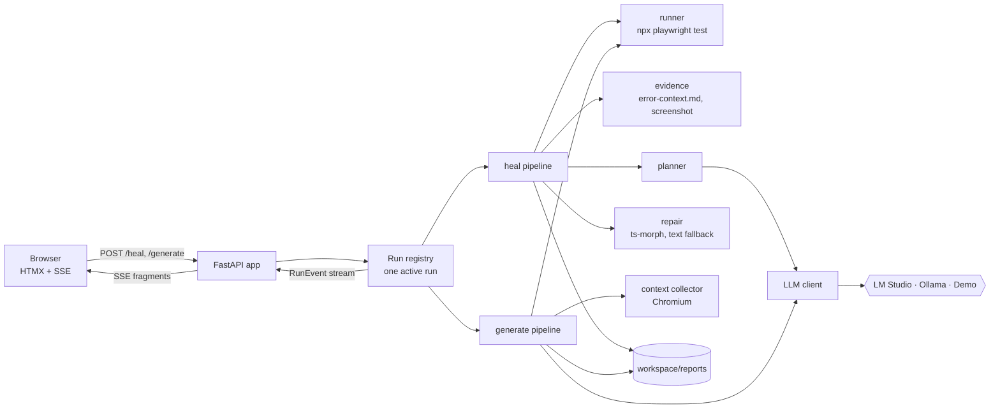

# Playwright Workbench v2: simplification and showcase redesign

- **Status:** Draft for review
- **Date:** 2026-10-03
- **Branch:** `v2`
- **UI design:** [Figma: Playwright Workbench — UI redesign](https://www.figma.com/design/eL5DUZmc85ESpusNSmxDkA)

## 1. Summary

The project does two useful things, generating Playwright tests and healing broken ones, but they are buried under
eight UI tabs, a home-made tracer, a router with provider fallback, a vision pipeline, benchmarks that measure
nothing meaningful, and 31 documentation files. v2 keeps the two features, fixes the correctness problems that
would not survive an interview, replaces the Gradio UI with a purpose-built FastAPI + HTMX app, and cuts everything
else.

### The pitch v2 has to support

> Give it a URL and a scenario and it writes a Playwright test. When a test breaks, it diagnoses why from the page
> as it was at the moment of failure, fixes the code with a syntax-tree edit, and proves the fix by re-running the
> test. If the failure looks like a real app bug, it refuses to patch the test. Every run leaves a report showing
> what the model saw, what it decided and why. It runs on local models through LM Studio or Ollama, and a scripted
> demo model lets anyone try it without one.

## 2. Goals, non-goals and success criteria

### Goals

1. **Easy to explain.** Two features (Generate, Heal), one loop, one report type, two screens.
2. **Correct where it matters.** Evidence comes from the failure itself; the "structured output" claim is true; the
   sample heal works on first launch.
3. **Looks like a product.** The UI matches the Figma design, including empty, loading, error and edge states.
4. **Transparent AI.** Every model call is inspectable: what was sent (by section and size), what came back, and
   whether it passed validation.
5. **Credible engineering hygiene.** Typed, linted, tested at unit, integration and UI level, with accessibility
   checks, in CI.
6. **Trackable.** A roadmap in the repository says what is done, in progress, planned and removed.

### Non-goals

- A command-line interface. The app is used through its web UI only. A launcher command that starts the server is
  the only entry point.
- Vision-based generation, benchmarks, run history, multi-user use, authentication, Docker, dark mode, mobile
  layouts.
- Cloud model providers. LM Studio and Ollama are supported; the scripted demo model covers the no-model case.
- Running Playwright's own Test Agents from the app (see section 4, decision D9).

### Success criteria

| # | Criterion | How it is checked |
| --- | --- | --- |
| S1 | A first-time visitor can launch the app and heal the sample with no `.env` and no model installed | UI test: fresh workspace → Demo provider → sample heals |
| S2 | With LM Studio or Ollama running, the app finds it and lists its models without configuration | Unit tests on provider detection; manual check against both |
| S3 | Healing evidence comes from the failing run, not a fresh page load | Integration test asserts the snapshot used is the run's `error-context.md` |
| S4 | A suspected app bug stops the heal without editing the test | Integration test with the "checkout" sample |
| S5 | Every screen and state in the Figma file exists in the app | UI tests cover each state; checklist in the plan |
| S6 | All quality gates pass in CI | CI is green on `v2` before merging to `main` |
| S7 | The README explains the project in under a minute, with a GIF of a heal | Review |

## 3. What the brainstorm established

- **Simplify, don't rebuild.** The "trustworthy healer + benchmark" rebuild was considered and rejected as too
  large. v2 is the existing project, smaller and fixed.
- **Benchmarks go.** The only published number (4/4 for a string-matching classifier on four hand-written logs) was
  circular, and the mutation and intent-validation modules were unused.
- **Gradio goes.** It is replaced with FastAPI, server-rendered Jinja templates, HTMX and server-sent events.
- **No chat UI and no raw "thinking".** The healer makes one structured call per attempt. Transparency comes from
  the model's structured reasoning and a Model I/O view.
- **Keep the project's own engine** rather than adopting Playwright Test Agents, but use Playwright's own failure
  snapshot and accessibility snapshot instead of custom code (decision D9).

## 4. Key decisions

| ID | Decision | Rationale |
| --- | --- | --- |
| D1 | Web UI only; no CLI, no `.env` | The user picks the provider and model in the UI. Fewer entry points and no setup file make the project easier to run and explain. |
| D2 | FastAPI + Jinja + HTMX + SSE, no front-end build | Full visual control without a second app or toolchain. Live progress maps directly onto server-sent events. |
| D3 | One report type per run (`HealReport`, `GenerateReport`) | Replaces decision artifacts, timelines, traces and provenance records that overlapped. The UI, downloads and tests read the same object. |
| D4 | Providers: LM Studio, Ollama, Demo | Both local servers speak the OpenAI API, so one client covers both. Demo replays recorded answers so the app works without a model. |
| D5 | Evidence from Playwright's `error-context.md` and the run's own output folder | Playwright already snapshots the page at the moment of failure. Re-opening the start page described the wrong state for any multi-step test. |
| D6 | `page.aria_snapshot(mode="ai")` replaces the custom CDP accessibility code; `page.console_messages()`, `page.page_errors()` and `page.requests()` replace the custom listeners | Public, maintained Playwright APIs; less code. `mode="ai"` is the format Playwright itself writes into `error-context.md`, so Generate and Heal show the model the same snapshot format. |
| D7 | Ask the model for JSON-schema output, then validate with Pydantic | Makes "structured output" true. If a provider rejects the schema, retry once without it and rely on validation. |
| D8 | App-defect guard | If the model diagnoses `POTENTIAL_APP_DEFECT` with confidence ≥ 0.7, the heal stops without editing the test. One rule, and it answers the main criticism of self-healing: hiding real bugs. |
| D9 | Keep the custom engine; compare with Playwright Test Agents in the README | Test Agents are prompts plus MCP tools run inside a coding assistant, with free-form edits (including assertions) and `test.fixme()` when stuck. This project is a standalone, local-model pipeline with constrained, auditable fixes. Replacing the engine would leave nothing to show. |
| D10 | Package becomes `workbench` under `src/` | `from src.healing import ...` uses `src` as a package name, which is an anti-pattern. A proper src-layout package fixes imports and packaging. |
| D11 | All runtime output goes to one git-ignored `workspace/` folder | Replaces `tests/generated`, `tests/artifacts`, `tests/screenshots`, `logs/` and `benchmarks/reports`. |
| D12 | pytest style tests in `tests/unit`, `tests/integration`, `tests/ui` | Clear levels, modern style. Tests are rewritten as the modules they cover change. |
| D13 | Python 3.13, Playwright 1.63.0 (Python and npm pinned to the same exact version), Node 24 | Current, supported versions. Matching pins keep the Python library and the test runner on the same browser builds. Node 20 reached end of life in April 2026. |
| D14 | The runner reads Playwright's JSON report, not terminal output | Verified on 1.63: the JSON report gives each test's status, error message and location, and the exact paths of that test's screenshot and `error-context.md`. Replaces stdout parsing and screenshot globbing. |
| D15 | Verification re-runs are recorded as video with each action captioned | Playwright 1.59+ `video.show.actions`. The healed screen offers "Watch the re-run": visible proof the fix works, and footage for the README GIF. Only verification runs are recorded, to keep the workspace small. |

## 5. Product scope

### 5.1 Features

| Feature | Behaviour |
| --- | --- |
| **Heal** | Run a spec, collect evidence from the failure, ask the model for a diagnosis and a fix, apply it to the syntax tree (text replacement as fallback), re-run. Repeat up to N attempts (1–5, default 3). Stop early on a suspected app bug. Each verification re-run is recorded as a captioned video. |
| **Heal samples** | Two bundled samples against a sample site the app serves itself: *Selector drift* (heals) and *App bug* (stops without editing). Sample specs contain a `{{BASE_URL}}` placeholder that is filled in when they are copied into the workspace, so they work on any port. With Demo the outcomes are deterministic; with a real model they depend on the model. |
| **Upload** | Heal your own single-file `.spec.ts` (max 200 KB). The upload is copied into the workspace; the original is never modified. Specs that import local helpers or page objects are not supported. |
| **Generate** | URL + scenario → collect page context in one Chromium session → model writes the spec → optionally run it. A failed run offers **Heal this test**. |
| **Model selection** | Header pill opens a popover: provider (LM Studio, Ollama, Demo), server URL, model list from `/v1/models`, connection status. The choice is saved to `workspace/settings.json`. |
| **Reports** | Each run writes one JSON report to `workspace/reports/`. The UI shows it; **Download report** saves it. |
| **Model I/O** | For each attempt: the sections sent to the model with their sizes and truncation, the raw response, and validation status. |

### 5.2 Screens and states

All of these are designed in the Figma file. The app must implement each one.

| Area | States |
| --- | --- |
| Global | Model connected · Demo · Not connected (header pill and popover) |
| Heal | Idle · Running (live steps + log) · Healed · Healed after retries · Not healed (attempts exhausted) · **Stopped: likely app bug** (new, see 5.3) · Nothing to heal · Cancelled · Model unreachable |
| Heal attempt outcomes | Healed · Re-run failed · Fix not applied · Invalid model reply |
| Heal result tabs | Diff · Re-run video · Execution log · Model I/O |
| Generate | Empty · Generating · Passed · Generated, not run · Run failed → Heal |
| Banners | Playwright browsers missing (blocking) · Page context unavailable · Repair used text replacement |
| Input errors | Invalid URL · Not a spec file · File too large |

### Generate guidance and examples (amended 2026-10-18)

Keep the project a small, auditable healing showcase. Generate collects only
its starting page; explain this beside Scenario and near the README's opening.
Later pages and controls revealed after interaction are not inspected. This
amendment adds guidance and examples, not autonomous exploration or retries.

Keep the bundled Contact form as the Demo example. Label bundled Checkout as
an expected app failure. On the Generate idle screen, show public practice
cards for Sauce Demo's locked-out account and The Internet's customer table
and checkbox checks. Cards display the scenario, source site, and local-model
requirement. Use example fills URL and Scenario without starting a run. Under
Demo, show the cards with disabled actions and guidance to choose LM Studio or
Ollama; public example query parameters must not prefill unsupported Demo runs.

Keep the README scenarios identical to the form presets. Explain external-site
and model variability and retain the bundled example as the local alternative.
Automated UI tests verify prefilling without visiting third-party sites; live
model validation is separate from deterministic CI.

### 5.3 Figma changes to make during the UI phase

1. Popover footnote: "Defaults come from .env" becomes "Saved on this machine".
2. Sample card: two samples (*Selector drift*, *App bug*) instead of one.
3. New result state **Stopped: likely app bug**: warning pill, the diagnosis and its evidence, and "The test was not changed." The existing "Not healed" screen remains for exhausted attempts.
4. A **Re-run video** tab on the healed screens: the recorded verification run with action captions, plus its length and a download link.

Once the UI phase lands, the templates are the source of truth. Figma is updated only for these four changes.

## 6. Architecture

### 6.1 Repository layout

```text
.
├── src/workbench/
│   ├── __init__.py
│   ├── __main__.py            # launcher: starts uvicorn on 127.0.0.1:7860 and opens the browser
│   ├── app.py                 # FastAPI app factory, routes, SSE endpoint
│   ├── config.py              # paths (workspace, samples, prompts), limits, defaults
│   ├── settings.py            # load/save workspace/settings.json (provider, server URL, model)
│   ├── runs.py                # in-memory run registry: one active run, event queue, cancel flag
│   ├── reports.py             # write/read/list reports in workspace/reports
│   ├── validation.py          # URL, scenario and upload checks (from src/utils/validation.py)
│   ├── models/                # Pydantic data contracts
│   │   ├── shared.py          # FailureType, RunResult, Provenance, PromptSection, ModelExchange
│   │   ├── heal.py            # HealingAnalysis (LLM contract), Attempt, HealReport
│   │   ├── generate.py        # GenerateReport, ContextSummary
│   │   └── events.py          # RunEvent (what the UI streams)
│   ├── llm/
│   │   ├── client.py          # chat(), list_models(), ping(); schema-constrained output with fallback
│   │   ├── parsing.py         # parse_llm_response(), extract_code_block() (from src/utils/llm.py)
│   │   ├── prompts.py         # load_prompt(), prompt version and hash (from src/utils/prompt_loader.py)
│   │   ├── providers.py       # LM Studio, Ollama, Demo: default URLs and detection
│   │   └── demo.py            # scripted answers for the bundled samples
│   ├── context/
│   │   ├── collector.py       # one Chromium session: DOM, aria snapshot, console, network
│   │   ├── dom.py             # cleaned HTML
│   │   └── locators.py        # locator candidates parsed from the aria snapshot
│   ├── generate/
│   │   └── pipeline.py        # generate(request, emit, cancel) -> GenerateReport
│   ├── heal/
│   │   ├── pipeline.py        # heal(request, emit, cancel) -> HealReport   (the only heal loop)
│   │   ├── classifier.py      # rule-based failure hint (unchanged logic)
│   │   ├── evidence.py        # error-context.md, the run's screenshot, error log
│   │   ├── planner.py         # builds prompt sections, calls the model, records ModelExchange
│   │   ├── repair.py          # AST bridge + text fallback
│   │   └── ast_repair.js      # ts-morph script (moved from scripts/)
│   ├── runner.py              # cancellable `npx playwright test`, per-run output folder
│   ├── prompts/               # generator.md, healer.md, manifest.json
│   └── web/
│       ├── templates/         # base.html, heal.html, generate.html, partials/*.html
│       └── static/            # css/tokens.css, css/app.css, fonts/, vendor/htmx-*.js, img/
├── samples/
│   ├── site/                  # sample web app: contact form (drift), checkout (500 on submit)
│   ├── specs/                 # contact.spec.ts (drifted selector), checkout.spec.ts (app bug)
│   └── recordings/            # Demo provider answers, keyed by sample and prompt
├── tests/
│   ├── unit/                  # pytest, no browser, no model
│   ├── integration/           # real Chromium + sample site + Demo provider
│   └── ui/                    # Playwright Test (TypeScript) against the running app, with axe
├── docs/
│   ├── architecture.md
│   ├── decisions.md
│   ├── development.md
│   ├── assets/                # demo.gif, screenshots
│   └── superpowers/           # specs and plans (process documents)
├── workspace/                 # git-ignored runtime folder (created on first run)
├── playwright.config.ts           # project's own UI tests (tests/ui)
├── playwright.workspace.config.ts # used by the runner for generated, uploaded and sample specs
├── AGENTS.md  CLAUDE.md  README.md  ROADMAP.md  CHANGELOG.md  CONTRIBUTING.md  SECURITY.md  LICENSE
├── pyproject.toml  uv.lock  package.json  package-lock.json  tsconfig.json  eslint.config.cjs
└── .github/  (workflows/ci.yml, workflows/codeql.yml, dependabot.yml)
```

### 6.2 Runtime data flow



- A request starts a run in a background thread and returns a page fragment subscribed to
  `GET /runs/{id}/events`.
- Pipelines report progress through an `emit(RunEvent)` callback and check a `cancel` flag between steps. The run
  registry renders each event as an HTML fragment and pushes it over SSE, so there is no client-side state.
- When a run finishes, its report is written and the result view is rendered from the report.
- Only one run at a time. Starting another returns `409` and the UI keeps its buttons disabled while a run is active.

### 6.3 HTTP routes

| Route | Purpose |
| --- | --- |
| `GET /` | Redirect to `/heal` |
| `GET /heal`, `GET /generate` | Full pages |
| `POST /heal` | Start a heal: `sample=<name>` or an uploaded file, plus `max_attempts` |
| `POST /generate` | Start a generation: `url`, `scenario`, `run_after` |
| `POST /runs/{id}/cancel` | Cancel the active run |
| `GET /runs/{id}/events` | SSE stream of rendered fragments |
| `GET /reports/{id}` | Result view for a finished run (also used after a page reload) |
| `GET /reports/{id}.json` | Download the report |
| `GET /reports/{id}/spec` | Download the fixed or generated spec |
| `GET /reports/{id}/video` | Stream the verification re-run video |
| `GET /model`, `POST /model` | Popover content; save provider, server URL and model |
| `POST /model/test` | Test the connection and refresh the model list |
| `GET /sample-site/...` | Static sample web app used by the bundled samples |
| `GET /healthz` | Liveness, used by tests |

### 6.4 Data contracts

```text
RunResult       status(passed | failed | timed_out | error), duration_ms, error_message, error_location,
                screenshot_path?, error_context_path?, video_path?, stdout, stderr
                (built from Playwright's JSON report)
Provenance      provider, model, prompt_name, prompt_version, prompt_hash,
                input_tokens, output_tokens, latency_ms
PromptSection   name, chars, original_chars (set when truncated)
ModelExchange   sections[PromptSection], raw_response, valid, validation_error, provenance
HealingAnalysis LLM output contract: failure_type, failure_summary, hypothesis, confidence_score,
                confidence_rationale, reasoning_steps, root_cause_evidence, action{original_code,
                fixed_code, description, repair_strategy}
Attempt         number, analysis?, exchange?, outcome(healed | rerun_failed | not_applied |
                invalid_reply | app_defect | cancelled), repair_method(ast | text)?, rerun?, duration_ms
HealReport      id, spec_name, status(healed | not_healed | app_defect_suspected | nothing_to_heal |
                cancelled | error), attempts[], original_code, final_code, diff, warnings[],
                classifier_hint, started_at, duration_ms
GenerateReport  id, url, scenario, status(passed | failed | not_run | error), code,
                context(ContextSummary), exchange, run?, started_at, duration_ms
RunEvent        run_id, seq, kind(step | log | attempt | done), step?, state?, detail, elapsed_ms
```

`HealingAnalysis` stays close to today's schema so the prompt and the planner tests carry over. Report IDs use
`YYYYMMDD-HHMMSS-<kind>-<slug>`.

### 6.5 Engine changes

| # | Change | Detail |
| --- | --- | --- |
| E1 | Per-run output folder and JSON report | The runner calls `npx playwright test <spec> --config playwright.workspace.config.ts --output workspace/runs/<id>/test-results --reporter=json` with `PLAYWRIGHT_JSON_OUTPUT_FILE=workspace/runs/<id>/report.json`, and builds `RunResult` from that report. The screenshot, `error-context.md` and video paths come from the report's attachments, so they always belong to this run. Fixes the "newest PNG anywhere" bug. |
| E2 | Evidence from the failure | `evidence.py` reads the `error-context.md` attachment. Verified on 1.63, it holds the error, the test source with the failing line marked, and the page snapshot taken at the moment of failure (mid-test state included). The planner sends the snapshot and the marked source as separate prompt sections and drops Playwright's own "Instructions" header. If there is no attachment, evidence falls back to collecting context from the spec's `page.goto` URL, and adds the "Page context unavailable" warning when that fails too. |
| E3 | Aria snapshot | The context collector uses `page.aria_snapshot(mode="ai", depth=…)`, the same format as `error-context.md`. `locators.py` derives role/name candidates from it. `accessibility.py` (CDP) is deleted. |
| E4 | Model I/O capture | The planner builds named prompt sections, records their sizes and truncation, stores the raw response and validation result in a `ModelExchange`. |
| E5 | Schema-constrained output | `client.chat()` sends `response_format` with the `HealingAnalysis` JSON schema; on a provider error it retries once without it. Pydantic validation always runs. |
| E6 | One heal loop | `heal/pipeline.py` replaces both `attempt_healing` and `heal_test_streaming`, emits `RunEvent`s and honours cancellation. |
| E7 | App-defect guard | Decision D8. Outcome `app_defect`, report status `app_defect_suspected`, test file unchanged. |
| E8 | Cancellation | The runner starts Playwright in its own process group and kills the group on cancel. Pipelines check the flag between steps. |
| E9 | Environment checks | At startup and before each run: Node available (else text-replacement warning), Chromium installed (else blocking banner with the install command). |
| E10 | Prompts | Move to the package; healer prompt bumped to v3 (section headers, schema output), generator to v3. Vision prompt deleted. |
| E11 | Built-in page signals | The collector reads `page.console_messages()`, `page.page_errors()` and failed entries from `page.requests()` after navigation. `console.py` and `network.py` (custom listeners) are deleted. |
| E12 | Re-run video | `playwright.workspace.config.ts` enables `video: { mode: "on", show: { actions: { position: "top-right" }, test: { level: "title" } } }` when `WORKBENCH_RECORD_VIDEO=1`. The runner sets it for verification runs only; the video path comes from the JSON report and is stored on the attempt. |

### 6.6 Providers and settings

- **Defaults:** LM Studio `http://localhost:1234/v1`, Ollama `http://localhost:11434/v1`, Demo (in-process).
- **First launch:** probe LM Studio, then Ollama. Use the first that answers, with its first listed model. If
  neither answers, show the "model unreachable" state, which offers to switch to Demo.
- **Saved choice:** provider, server URL and model are written to `workspace/settings.json` and reused next time.
- **Demo provider:** answers come from `samples/recordings/`, matched by sample and prompt kind. Prompts that match
  no recording get a clear "Demo only covers the bundled samples" error. Demo runs are labelled everywhere.
- **No environment variables are required.** Two optional ones exist for tests and CI only: `WORKBENCH_PORT` and
  `WORKBENCH_WORKSPACE`.

### 6.7 UI implementation

- **Templates:** `base.html` (header, model pill, popover), `heal.html`, `generate.html`, and one partial per
  repeated element (`step_row`, `attempt_card`, `banner`, `pill`, `code_pane`, `diff_pane`, `model_io`,
  `diagnosis_card`).
- **Styles:** `tokens.css` mirrors the 30 Figma colour variables one-to-one (`bg/canvas` becomes
  `--bg-canvas`) plus the 8 type styles. `app.css` holds layout and components using simple class names
  (`.btn`, `.btn--primary`, `.pill`, `.pill--pass`).
- **Fonts:** Inter and JetBrains Mono, self-hosted as `woff2` (both under the SIL Open Font License).
- **Code and diffs:** highlighted on the server with Pygments; diffs from `difflib`. No client-side libraries apart
  from HTMX and its SSE extension, vendored with their versions in the file names.
- **Accessibility:** semantic landmarks, visible focus, keyboard-operable popover and tabs, status changes announced
  through `aria-live`, colour never the only signal (icons and text accompany every status). Checked with axe in
  the UI tests.
- **Desktop only:** minimum supported width 1280px.

## 7. Removals

| Remove | Reason |
| --- | --- |
| `src/app.py` (Gradio) and the `gradio` dependency | Replaced by FastAPI + HTMX |
| `src/agents/` (generator, healer CLI) | Logic moves into `generate/` and `heal/`; no CLI |
| `src/services/` (generation, healing, vision, workbench) | Replaced by pipelines and routes |
| `src/observability/` and `logs/` | Duplicated the reports |
| `src/llm/router.py`, `registry.py`, `policies.py` | Replaced by one small client |
| Vision: `vision_service.py`, `prompts/vision.md`, `VisionDecision`, vision model settings | Out of scope |
| `src/context/accessibility.py` (CDP), `screenshot.py`, `console.py`, `network.py` | Replaced by `aria_snapshot(mode="ai")`, the run's own screenshot, and Playwright's built-in console, error and request collections |
| `src/utils/` | `validation.py`, `llm.py` and `prompt_loader.py` move (see 6.1); `browser.py`, `formatting.py` and `logger.py` are folded into their callers, with logging configured once in `__main__.py` |
| `schemas/` (top level) | Moves to `workbench.models`, with obsolete types removed (`ExecutionTimeline`, `TraceMetadata`, `BenchmarkRun`, `EvaluationResult`, ...) |
| `benchmarks/` | Decision in section 3 |
| `Dockerfile`, `.dockerignore`, `.github/workflows/docker.yml`, `docs/docker.md` | Needs a host model and browser anyway |
| `.env`, `.env.example`, `python-dotenv`, `docs/env-variables.md` | Decision D1 |
| `docs/` except `assets/`: `ai-systems-engineering.md`, `architecture/*`, `development/*`, `evaluation/*`, `prompts/*`, `governance.md`, `workbench-ui.md`, `README.md` | Replaced by three documents (section 9) |
| `tests/unit_test_*.py`, `tests/e2e/`, `tests/fixtures/`, `tests/generated/`, `playwright.e2e.config.ts` | Replaced by the new test layout; fixtures move to `samples/` |
| Process-history names ("Phase 17", "Stage 5", "IA-4") in code and tests | Noise |

## 8. Quality gates

| Gate | Tool | Where | Threshold |
| --- | --- | --- | --- |
| Python format and lint | ruff (current rule set) | pre-commit, CI | no errors |
| Python types | mypy, `strict = true` for `src/workbench` | CI | no errors; any relaxation is per-module with a comment |
| Unit tests | pytest + pytest-cov | CI | all pass; line + branch coverage ≥ 85% on `src/workbench` |
| Integration tests | pytest, real Chromium, sample site, Demo provider | CI | all pass |
| UI tests | Playwright Test (TS) against the running app with Demo | CI | all states in section 5.2 covered; HTML report uploaded |
| Accessibility | `@axe-core/playwright` in UI tests | CI | no serious or critical violations on Heal, Generate and the popover |
| TypeScript | `tsc --noEmit`, ESLint (+ `eslint-plugin-playwright`), Prettier | pre-commit, CI | no errors |
| Markdown | markdownlint-cli2 | pre-commit, CI | no errors |
| Security | CodeQL (Python, JS/TS, Actions), ruff `S` rules | CI, weekly | no new alerts |
| Dependencies | Dependabot (uv, npm, Actions), monthly, grouped | GitHub | reviewed PRs |

CI runs four jobs: `lint`, `unit`, `integration`, `ui`. Coverage is printed in the unit job's summary and the job
fails under 85%. The README shows two badges: CI and license. (Amended 2026-10-11: `main` removed Codecov in PR #18
before v2 merged, and v2 follows it.)

### Testing approach

- **Unit:** classifier rules, repair (AST and text, including the ts-morph script through Node), planner prompt
  sections and truncation, client fallback when `response_format` is rejected, provider detection, settings
  persistence, Demo matching, heal loop outcomes with a fake client and fake runner (healed, retry, not applied,
  invalid reply, app defect, cancelled, nothing to heal), report round-trip, routes and upload validation via
  FastAPI's `TestClient`.
- **Integration:** both samples end to end with real Playwright and the Demo provider; a generation against the
  sample site; evidence assertion for S3.
- **UI:** one spec per screen state family; the heal happy path doubles as the recording for the README GIF.

## 9. Documentation and tracking

| File | Content |
| --- | --- |
| `README.md` | Pitch, GIF, three-step quick start, how it works (one diagram), screenshots, "How this compares to Playwright Test Agents", tech stack with reasons, links |
| `ROADMAP.md` | Status of every item: ✅ Done, 🚧 In progress, 🔭 Planned, 🗑️ Removed (with reason). Updated in the same commit as the work. |
| `CHANGELOG.md` | Keep a Changelog format; v2.0.0 summarises this redesign |
| `docs/architecture.md` | Modules, data flow, data contracts, the heal loop in detail |
| `docs/decisions.md` | Still-valid ADRs (Pydantic schemas, ts-morph, prompts as files, single browser session) plus D1–D12 |
| `docs/development.md` | Setup, running tests, quality gates, conventions, adding a prompt version |
| `AGENTS.md` | Rewritten for v2: layout, where code goes, commands, conventions |
| `CLAUDE.md` | `@AGENTS.md`, so Claude Code and other agents share one source |
| `CONTRIBUTING.md`, `SECURITY.md` | Updated (security: the app runs specs you give it; binds to 127.0.0.1 only) |

### ROADMAP.md format

```markdown
## Now
| Item | Status | Phase | PR |
| --- | --- | --- | --- |
| FastAPI + HTMX UI | 🚧 In progress | 4 | #NN |

## Next
## Later (future goals)
## Done
## Removed
| Item | Reason |
```

Initial "Later" items: CI integration (GitHub Action that heals failing specs and opens a PR or flags an app bug),
classifier treats "waiting for locator" timeouts as locator problems, cloud providers (Anthropic, OpenAI),
run history page, a benchmark built from a mutated sample app, comparing heals with Playwright's healer agent, dark
mode, repository rename.

## 10. Conventions

- **Python:** package `workbench`; modules are nouns (`runner`, `reports`), pipeline entry points are verbs
  (`heal()`, `generate()`); Pydantic models are nouns with role suffixes (`HealReport`, `ModelExchange`,
  `RunEvent`); no module-level side effects; all model output parsed through Pydantic, never `json.loads` alone.
- **Templates:** `pages` are `heal.html` and `generate.html`; partials in `partials/` named after the component.
- **CSS:** custom properties named after Figma variables (`--status-pass-bg`); component classes with BEM-style
  modifiers.
- **Specs:** kebab-case file names (`contact-form.spec.ts`); generated names come from the scenario.
- **Prompts:** any content change bumps the version in `prompts/manifest.json`; the hash is computed.
- **Commits:** Conventional Commits; one phase per pull request into `v2`; `ROADMAP.md` updated in the same commit
  as the work.

## 11. Delivery phases

Work happens on the `v2` branch, one pull request per phase, and `v2` merges into `main` once Phase 5's gates
pass. Every phase ends with all existing gates green. The Gradio UI is deleted in Phase 1, so `v2` has no UI until
Phase 4; that is acceptable because `main` keeps the current version until the merge.

| Phase | Scope | Done when |
| --- | --- | --- |
| 1. Foundation | `src/workbench` package; pytest layout; delete section 7 items that nothing depends on; dependency changes; upgrade to Python 3.13, Playwright 1.63.0 and Node 24 (D13); `ROADMAP.md`, `CHANGELOG.md`, new `AGENTS.md`, `CLAUDE.md` | Package imports cleanly; remaining tests pass under pytest on the new versions; roadmap lists all phases |
| 2. Engine | E1–E12; unified reports; heal and generate pipelines with events and cancellation | Unit tests cover every heal outcome; integration test proves S3 and S4 with a fake client and records a re-run video |
| 3. Providers and samples | LLM client, provider detection, settings, Demo provider and recordings, `samples/` site and specs | S1 and S2 pass at pipeline level |
| 4. Web UI | FastAPI app, templates, CSS tokens, SSE, every state in section 5.2; Figma changes in 5.3 | Manual walkthrough of all states; route tests pass |
| 5. Quality gates | Integration and UI suites, axe, coverage gate, CI rework, Dependabot, removed workflows | S5 and S6 |
| 6. Showcase | README, GIF, screenshots, docs, ROADMAP and CHANGELOG final, version 2.0.0 | S7; docs lint clean |

## 12. Risks

| Risk | Mitigation |
| --- | --- |
| `error-context.md` or the JSON report changes format | Playwright is pinned to an exact version; evidence falls back to page collection; an integration test fails loudly if the attachment or its "Page snapshot" section disappears |
| Re-run videos fill the disk | Only verification runs are recorded, at the default 800×450 scale; videos live under `workspace/runs/<id>/` and are deleted with the run |
| A provider rejects `response_format` | One retry without it, then Pydantic validation; covered by a unit test |
| Small local models give weak diagnoses | Out of our control; the UI shows confidence and the Model I/O so a weak answer is visible, not hidden |
| SSE behaves differently behind proxies | Local tool on 127.0.0.1 only; not a target |
| Rewriting tests loses coverage of existing behaviour | Port the classifier, AST repair and planner tests first, before changing those modules |
| Scope creep during the UI phase | Section 5.2 is the full list; anything else goes to ROADMAP "Later" |

## 13. Open questions

1. **Repository name.** "workbench" suggests a collection of tools. Renaming (for example to
   `playwright-heal-workbench`) changes the GitHub URL, so it is listed under "Later" and left to you.
